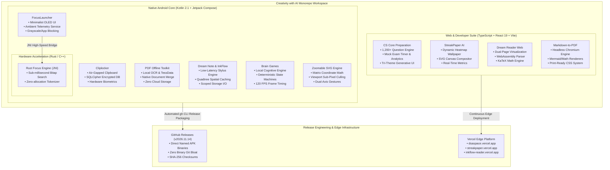

# Creativity with AI

<p align="center">
  <em>A unified, privacy-first polyglot monorepo engineering minimalist Android systems, zero-knowledge air-gapped utilities, native document processing engines, and AI-accelerated developer tools.</em>
</p>

<p align="center">
  <!-- Dynamic Status Badges -->
  
  
  
  
  
</p>

<p align="center">
  <!-- Tech Stack Badges -->
  
  
  
  
  
  
  
  
  
</p>

<p align="center">
  <!-- PRIMARY ACTION BUTTONS -->
  <a href="https://github.com/RayAashish/creativity-with-ai/releases/tag/v2026.11.14">
    
  </a>
  <a href="https://dsaspace.vercel.app/">
    
  </a>
  <a href="https://streakpaper.vercel.app/">
    
  </a>
</p>

---

## Overview & Key Highlights

### Problem Statement
Modern consumer software ecosystems have largely devolved into surveillance-heavy, dopamine-extractive feedback loops. Simple daily tasks—such as launching an application, clipboard history management, document reading, vector editing, and interview preparation—now routinely demand persistent cloud authentication, invasive advertising SDKs, background telemetry daemons, and constant internet connectivity.

### Core Value Proposition
**Creativity with AI** is an engineering monorepo designed to eliminate digital friction and surveillance capitalism. It provides a synchronized suite of **Native Android Applications** (engineered in modern Kotlin, Jetpack Compose, and low-latency native Rust) and **High-Throughput Web Applications** (engineered in TypeScript, React, and WebAssembly). Every tool operates under strict deterministic constraints: **Offline-First**, **Zero-Surveillance**, and **Hardware-Accelerated Execution**.

### Feature Matrix

| Sub-System / Capability | Traditional Proprietary Tools | Creativity with AI Monorepo Suite | Primary User Benefit |
| :--- | :--- | :--- | :--- |
| **App Launching & Screen Time** | Algorithmic badges, notification spam, colorful dopamine hooks | **FocusLauncher (Kotlin/Compose/Rust)**: Pure OLED black, sub-millisecond JNI fuzzy search, ambient telemetry | Regain 2–3 hours of daily focus; zero ad tracking or app profiling |
| **Clipboard Synchronization** | Unencrypted cloud clipboard sync, telemetry logging passwords | **Cliplocker (Air-Gapped Android)**: SQLCipher local encryption, zero `INTERNET` permission | Hardware-isolated secrets; immunity from network-based data leaks |
| **PDF & Document Processing** | Cloud-upload conversions with monthly SaaS subscriptions | **PDF Offline Toolkit & Markdown-to-PDF**: On-device native Canvas & WebAssembly KaTeX rendering | Publication-grade vector outputs; 100% data residency on user hardware |
| **CS Core & Pattern Preparation** | Disjointed web scrapers, paywalled question banks, online trackers | **CS Core Preparation & DSA Space**: 1,200+ structured gate-level problem bank, interactive mock engine | Comprehensive offline mastery covering OS, Networks, DBMS, OOP & DSA |
| **Vector & Graphic Navigation** | Heavy browser memory leaks when rendering complex SVG nodes | **Infinitely Zoomable SVG**: Native double-precision floating matrix engine with sub-pixel viewport culling | Smooth 120 FPS panning on arbitrary scale complex architectural diagrams |
| **Cognitive Assessment** | Gamified ad breaks every 60 seconds with server leaderboard pings | **Brain Games**: Pure on-device executive function & working memory drills | Zero ad distraction, pure local state persistence |

---

## High-Level System Architecture



---

## Component Deep-Dive & Modular Breakdown

### 1. Presentation Layer
- **Declarative Reactive State (Jetpack Compose & React 19)**: Eliminates imperative DOM/View manipulation. UI components subscribe to immutable state flows (`StateFlow<T>` in Kotlin, `useSyncExternalStore` / reactive hooks in TypeScript).
- **Adaptive OLED & High-Contrast Themes**: Android launchers and Web apps incorporate triple-tier theming:
  - *Pure OLED Minimalist* (`#000000` pitch black background, single-pixel monospaced typography, battery saving).
  - *Dark Cyber / Titanium* (high contrast, muted slate borders, reduced ocular fatigue).
  - *Vibrant Accent* (dynamic color coding for conceptual tags, difficulty metrics, and live test analytics).
- **Spatial Gesture Handling**: The `infintely-zoomable-svg` and `dream-note-taking-app` components implement custom two-finger multi-touch gesture detectors with pointer ID tracking, velocity friction dampening, and clamping boundaries.

### 2. Core Native Engine & Compute Pipeline
- **Sub-Millisecond Rust JNI Engine (`anti-addication-launcher/native`)**:
  - Employs a compiled Rust library via Java Native Interface (JNI).
  - Implements modified bitap and n-gram substring matching algorithms over installed package metadata.
  - Eliminates garbage collector pause spikes during instant keystroke app filtering.
- **On-Device OCR & Document Parser (`pdf-offline-toolkit`)**:
  - Leverages local `tessdata` machine learning models for optical character recognition without transmitting document frames across network interfaces.
  - Generates searchable, multi-layer PDF vector outputs natively on Android devices.
- **Client-Side Analytical Test Engine (`cs-core-preparation`)**:
  - Implements a deterministic Fisher-Yates shuffle algorithm with subject-balanced stratified sampling across 6 CS disciplines: Operating Systems, Computer Networks, DBMS, OOP, DSA, and Quantitative Aptitude.
  - Provides real-time countdown clock synchronization, question flagging, and detailed post-exam competency radar analytics.

### 3. Data & I/O Pipeline
- **Air-Gapped Security Architecture**: Core applications such as `private-clipboard-manager` explicitly omit the `<uses-permission android:name="android.permission.INTERNET" />` flag in their Android manifests.
- **Encrypted Local Storage (SQLCipher + Room)**: Clipboard history, sensitive configuration, and notes are encrypted at rest using AES-256 encryption backed by the Android Keystore system.
- **Zero-Cloud Local State (`localStorage` & IndexedDB)**: Web applications utilize zero tracking cookies or external session databases. All user study progress, streak configurations, and mock test scores persist locally in browser storage.

---

## Direct APK Downloads & Live Demos

All Android binaries are compiled with ProGuard/R8 optimizations and distributed directly via official GitHub Releases. **No heavy APK binaries are tracked in Git history.**

### Android APK Releases (GitHub Release `v2026.11.14`)

| Application | Build Variant | Size | Direct Download Link |
| :--- | :--- | :--- | :--- |
| **FocusLauncher** | Release (Optimized) | 3.66 MB | [📥 Download `anti-addiction-launcher.apk`](https://github.com/RayAashish/creativity-with-ai/releases/download/v2026.11.14/anti-addiction-launcher.apk) |
| **Cliplocker** | Air-Gapped Release | 7.86 MB | [📥 Download `private-clipboard-manager.apk`](https://github.com/RayAashish/creativity-with-ai/releases/download/v2026.11.14/private-clipboard-manager.apk) |
| **PDF Offline Toolkit** | Air-Gapped Release | 32.27 MB | [📥 Download `pdf-offline-toolkit.apk`](https://github.com/RayAashish/creativity-with-ai/releases/download/v2026.11.14/pdf-offline-toolkit.apk) |
| **Dream Note & InkFlow** | Debug Build | 91.38 MB | [📥 Download `dream-notes.apk`](https://github.com/RayAashish/creativity-with-ai/releases/download/v2026.11.14/dream-notes.apk) |
| **Brain Games** | Release (Lean) | 2.21 MB | [📥 Download `brain-games.apk`](https://github.com/RayAashish/creativity-with-ai/releases/download/v2026.11.14/brain-games.apk) |
| **Zoomable SVG** | Debug Build | 18.03 MB | [📥 Download `infinitely-zoomable-svg.apk`](https://github.com/RayAashish/creativity-with-ai/releases/download/v2026.11.14/infinitely-zoomable-svg.apk) |

> 🔗 *Access the complete release hub and historical changelogs at [GitHub Releases v2026.11.14](https://github.com/RayAashish/creativity-with-ai/releases/tag/v2026.11.14).*

### Live Web Deployments

- 🌐 **DSA Space**: [https://dsaspace.vercel.app/](https://dsaspace.vercel.app/) — Algorithmic pattern visualizations and code mastery.
- 🌐 **StreakPaper**: [https://streakpaper.vercel.app/](https://streakpaper.vercel.app/) — Real-time developer streak wallpaper compositor.
- 🌐 **InkFlow Reader**: [https://inkflow-reader.vercel.app/](https://inkflow-reader.vercel.app/) — High-performance document and reading interface.
- 🌐 **AlgoMaster Pro**: [https://algomaster-pro.vercel.app/](https://algomaster-pro.vercel.app/) — Core computational problem-solving suite.

---

## Project Structure (Annotated ASCII Tree)

```text
creativity-with-ai/
├── .github/                               # CI/CD Workflows, release automations, issue templates
├── .gitignore                             # Master security & build artifact exclusion manifest
├── LICENSE                                # Repository-wide MIT License
├── README.md                              # Master architectural specification & distribution guide
│
├── anti-addication-launcher/              # [Android] Minimalist OLED anti-addiction launcher
│   ├── app/src/main/                      # Kotlin 2.1 + Jetpack Compose application source
│   ├── native/focus_search/               # Low-latency Rust NDK fuzzy search engine
│   └── build.gradle.kts                   # Modern Gradle build configuration
│
├── private-clipboard-manager/             # [Android] Air-gapped, SQLCipher-encrypted clipboard
│   ├── app/src/main/                      # Room Database, Keystore encryption, zero-INTERNET manifest
│   └── build.gradle.kts                   # Dependency injection & KSP processor setup
│
├── pdf-offline-toolkit/                   # [Android] 100% on-device OCR & document toolkit
│   ├── app/src/main/assets/tessdata/      # Embedded local optical character recognition models
│   └── build.gradle.kts                   # AndroidX PDF & native graphics bindings
│
├── dream-note-taking-app/                 # [Android] Low-latency stylus & markdown note platform
│   ├── ink-engine/                        # Hardware-accelerated canvas vector drawing pipeline
│   └── document/                          # Local notebook serialization & export handlers
│
├── brain-games/                           # [Android] Distraction-free cognitive & memory games
│   └── app/src/main/                      # Pure Compose game loops with zero ad telemetry
│
├── infintely-zoomable-svg/                # [Android] Double-precision infinite canvas SVG viewer
│   └── app/src/main/                      # Matrix coordinate transformation & sub-pixel culling
│
├── cs-core-preparation/                   # [Web] Comprehensive CS interview preparation platform
│   ├── src/                               # 1,200+ question bank, mock test runner & radar analytics
│   ├── package.json                       # React 19 + TypeScript 5.5 + Vite 6
│   └── vite.config.ts                     # Optimized tree-shaking & chunk splitting
│
├── dream-wallpaper/                       # [Web] StreakPaper developer wallpaper generator
│   └── src/                               # Dynamic SVG & Skia canvas generation engine
│
├── dream-reader-for-all-devices/          # [Web/Hybrid] Cross-platform responsive reader
│   └── src/                               # Dual-page virtualized reading interface
│
├── edit_image_text/                       # [Web] On-device browser image OCR & typography editor
│   └── src/                               # WebAssembly Tesseract pipeline
│
└── markdown-to-pdf/                       # [Web/CLI] Publication-grade PDF compiler
    └── src/                               # KaTeX math & Mermaid diagram rendering pipeline
```

---

## Getting Started & Local Development

### Prerequisites

| Runtime / SDK | Required Version | Purpose |
| :--- | :--- | :--- |
| **Java Development Kit (JDK)** | OpenJDK 17 or 21 | Android Gradle plugin & Kotlin compilation |
| **Android SDK & Build-Tools** | API Level 34 / 35 | Android application targeting |
| **Rust Toolchain & Cargo** | 1.80+ (`cargo-ndk`) | Compiling native Rust JNI libraries for Android ABIs |
| **Node.js & npm / pnpm** | Node.js 20+ (LTS) | Building TypeScript, React, and Vite web projects |
| **GitHub CLI (`gh`)** | 2.50+ | Automating GitHub Releases and artifact packaging |

### Environment Configuration

1. Clone the repository cleanly:
   ```bash
   git clone https://github.com/RayAashish/creativity-with-ai.git
   cd creativity-with-ai
   ```

2. Configure Android local properties:
   ```bash
   # Create local.properties inside any Android subproject (e.g., anti-addication-launcher)
   echo "sdk.dir=$ANDROID_HOME" > anti-addication-launcher/local.properties
   echo "sdk.dir=$ANDROID_HOME" > private-clipboard-manager/local.properties
   ```

3. Configure Web environment variables:
   ```bash
   # Copy the sanitized environment templates
   cp cs-core-preparation/.env.example cs-core-preparation/.env.local
   cp dream-wallpaper/.env.example dream-wallpaper/.env.local
   ```

---

## Build, Test & Deployment Pipeline

### Building Android Applications

```bash
# 1. Compile FocusLauncher (including native Rust JNI libraries)
cd anti-addication-launcher
./gradlew assembleRelease

# 2. Compile Air-Gapped Private Clipboard Manager
cd ../private-clipboard-manager
./gradlew assembleNoInternetRelease

# 3. Verify APK outputs
ls -lh app/build/outputs/apk/*/app-*.apk
```

### Building Web Applications

```bash
# Build the CS Core Preparation platform
cd cs-core-preparation
npm install
npm run build
npm run preview
```

### Packaging & Releasing Direct APKs (No Git Bloat)

```bash
# Authenticate GitHub CLI
gh auth status

# Upload release binaries with direct download links
TAG="v$(date +'%Y.%m.%d')"
gh release create "$TAG" \
  /path/to/anti-addiction-launcher.apk \
  /path/to/private-clipboard-manager.apk \
  /path/to/pdf-offline-toolkit.apk \
  --title "Release $TAG" \
  --notes "Production build assets for Creativity with AI suite."
```

---

## Security, Privacy & Air-Gapped Philosophy

### 1. Zero Network Permission Principle
Applications dealing with private personal data (such as `private-clipboard-manager`) strictly omit the network permission:
```xml
<!-- INTERNET permission is intentionally NOT declared in AndroidManifest.xml -->
<!-- This guarantees operating-system level prevention of data egress -->
```
Even if code inside the application were compromised by a malicious dependency, the Linux kernel sandbox on Android denies socket allocation, rendering data exfiltration impossible.

### 2. Hardware Keystore Encryption
All sensitive database columns are encrypted using SQLite encryption extensions (`SQLCipher`). Database master keys are derived dynamically through the **Android KeyStore Provider**, leveraging hardware-backed Secure Elements (SE) or StrongBox keymasters where available.

### 3. Scoped Storage & Zero File Pollution
All document and image utilities respect Android 11+ Scoped Storage requirements (`MediaStore` APIs). No legacy `READ_EXTERNAL_STORAGE` or `WRITE_EXTERNAL_STORAGE` broad storage permissions are requested.

---

## Roadmap & Versioning

- **Version 2026.11.x (Current Milestone)**:
  - [x] Complete monorepo security scrubbing and removal of legacy build caches.
  - [x] Air-gapped APK builds packaged and released via GitHub Releases (`v2026.11.14`).
  - [x] Live web deployment synchronization for DSA Space, StreakPaper, and InkFlow Reader.
  - [x] Implementation of Rust NDK fuzzy search in FocusLauncher.
- **Version 2027.Q1 (Upcoming)**:
  - [ ] WebAssembly compilation of the FocusLauncher search engine for the web dashboard.
  - [ ] Stylus pressure sensitivity curve tuning for the InkFlow canvas engine.
  - [ ] End-to-end local encrypted backup via local USB/OTG storage.

---

## License & Acknowledgments

This monorepo and its constituent sub-projects are licensed under the **[MIT License](LICENSE)**.

### Acknowledgments & Open-Source Foundations
- **Google Android Open Source Project (AOSP)** for Jetpack Compose and modern Android APIs.
- **The Rust Project** for memory-safe systems programming and high-performance cross-compilation.
- **React & Vite Teams** for responsive web application architecture.
- **SQLite & SQLCipher** for deterministic, serverless, encrypted data persistence.

---
<p align="center">
  <sub>Engineered with precision for human focus and digital privacy. Maintained by <a href="https://github.com/RayAashish">Aashish Kumar Ray</a>.</sub>
</p>
