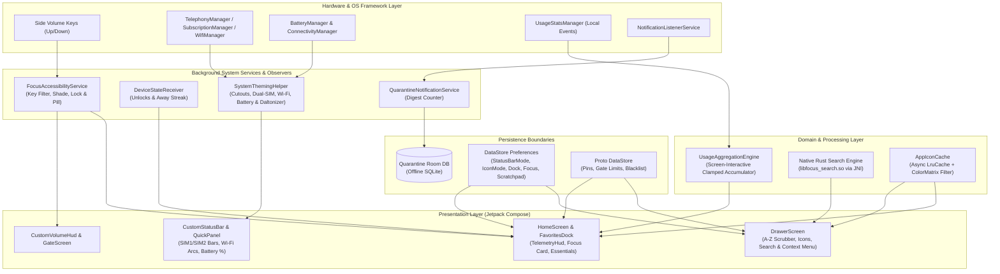

# FocusLauncher

<p align="center">
  <em>A zero-clutter, pure-black OLED hybrid minimalist Android launcher with its own custom Dual-SIM / Wi-Fi / Battery status bar, ambient accountability telemetry, real &amp; monochrome app icons, bottom favorites dock, and hardware dopamine gating.</em>
</p>

<p align="center">
  
  
  
  
  
  
  
</p>

<p align="center">
  <a href="https://github.com/RayAashish/creativity-with-ai/releases/download/v2026.11.26/focus-launcher-release.apk">
    
  </a>
  <a href="https://github.com/RayAashish/creativity-with-ai/releases/download/v2026.11.26/focus-launcher-debug.apk">
    
  </a>
</p>

---

## Overview & Key Highlights

### Problem Statement
Modern smartphone home screens are dopamine-engineered casinos — saturated icons, red badges, unconstrained notifications, and algorithmic feeds compete for every unlock. On the other hand, bare text-only minimalist launchers often swing too far the other way: they hide the top status bar with no replacement for Dual-SIM/network/Wi-Fi/battery telemetry, lack familiar favorites docks or A–Z quick scrolling, and force users to guess invisible gestures.

### Core Value Proposition
**FocusLauncher** combines the familiarity of a proper Android home screen with uncompromising anti-addiction discipline:
- **100% Offline Architecture:** Strictly zero network permissions (`android.permission.INTERNET` is never declared). Zero analytics, zero telemetry egress, zero cloud dependencies.
- **Custom FocusLauncher Status Bar (Default):** Replaces the stock Android status bar cleanly across display cutouts with custom Canvas-drawn **Dual-SIM signal strength bars (`5G`/`LTE`/carrier)**, **Wi-Fi RSSI signal arcs**, **proportional battery gauge (`%` + charging)**, **time**, **ringer/silent icon**, and **quiet alerts**, plus an interactive **System Status Quick Panel** on tap.
- **Hybrid Minimalist Home + Favorites Dock:** Smart first-run seeding for up to 8 pinned essentials and a 4–5 app **Bottom Favorites Dock**, paired with a sleek `> search apps...` pill (`[note]`, `[settings]`).
- **Real, Monochrome, or Text-Only Icons:** Off-main-thread cached app icons with instant switching between **Real Icons**, desaturated **Monochrome** icons, or **Text Only** mode.
- **A–Z App Drawer + Rich Long-Press Menu:** Interactive right-edge alphabet scrubber rail with floating preview bubble, Rust NDK sub-millisecond search, and long-press actions for **Pin to Home**, **Add/Remove Dock**, **Breathing Gate**, **App info**, and **Uninstall**.
- **Ambient Accountability & Satiety:** Live screen-time differential accumulator, unlock counter, break duration tracker, Memento Mori 24h progress bar, deliberate `[edit]`-guarded focus goal, and 45% satiety dimming with `[!]` badges.
- **Hardware-Level OS Hooks:** Physical volume-key interception (`CustomVolumeHud`), double-tap screen lock, floating session watchdog pill, and `WRITE_SECURE_SETTINGS` hardware grayscale mode.

### Feature Matrix

| Feature | Capability & Implementation Details |
| :--- | :--- |
| **Custom Top Status Bar** | Three modes (**Focus Bar** default, **System Bar**, **Hidden**). Renders Canvas-drawn Dual-SIM signal bars (`5G`/`LTE`/no-SIM), Wi-Fi arcs (`0..4`), battery shell + charge `%`, clock, mute/vibrate glyph, and quiet alert badge around center punch-hole cutouts. |
| **Interactive Status Panel** | Tap the top bar (or swipe down when Accessibility isn't bound) to inspect SIM1/SIM2 carriers, Wi-Fi level, battery state, expand Android Notification Shade, grant optional `READ_PHONE_STATE`, or switch bar modes. |
| **Ambient Telemetry HUD** | Live foreground aggregation via `UsageStatsManager.queryEvents()` with anomaly clamping against screen-interactive intervals, `KEYGUARD_HIDDEN` + `ACTION_USER_PRESENT` unlock tracking, and offline break timer (`away Xh Ym`). |
| **Memento Mori Progress** | Monospaced 20-character day progress bar (`day [================--] 92%`), updating every minute. |
| **Single Focus Intent Card** | Bordered `today's focus:` container with dedicated `[edit]` button to prevent accidental keyboard popups, inline `[save]` / `[esc]` actions, and 04:00 AM daily auto-rollover. |
| **Essentials & Bottom Dock** | Auto-seeded daily essentials (up to 8 apps) + bottom Favorites Dock (up to 5 icons) with usage tags (`· 38m`) and satiety dimming (`45%` opacity + grayscale + `[!]`). |
| **A–Z App Drawer & Search** | Native Rust JNI search (`libfocus_search.so`) with Kotlin fallback, right-edge A–Z scrubber rail, manual/auto-IME toggle, and full long-press app actions (**Pin**, **Dock**, **Gate**, **App info**, **Uninstall**). |
| **Full Gesture Engine** | Swipe Up (App Drawer), Swipe Down (Notification Shade / Scratchpad), Swipe Left (Settings), Swipe Right (Scratchpad), Long Press Home (Customize Menu), Double Tap (Screen Lock). |
| **Hardware Volume & Grayscale** | Intercepts `KEYCODE_VOLUME_UP`/`DOWN` via `FocusAccessibilityService` for a monospaced `CustomVolumeHud` and toggles hardware OS-wide grayscale via Daltonizer secure settings. |

---

## System Architecture & Workflow

### High-Level Architecture Diagram



---

## Project Structure

```text
anti-addication-launcher/
├── app/
│   ├── build.gradle.kts                # Build config (v1.1.0 / versionCode 2), NDK, Compose BOM
│   ├── proguard-rules.pro              # R8 shrinking & Protobuf/Room keep rules
│   └── src/
│       ├── main/
│       │   ├── AndroidManifest.xml     # Zero INTERNET perm; READ_PHONE_STATE / ACCESS_WIFI_STATE optional/local
│       │   ├── java/com/raysi/launcher/
│       │   │   ├── data/
│       │   │   │   ├── repository/     # Telemetry, Preferences (Bar/Icon/Dock), Settings, Inventory
│       │   │   │   ├── search/         # KotlinSearchEngine & RustSearchEngine JNI bridge
│       │   │   │   └── usage/          # UsageAggregationEngine & duration formatters
│       │   │   ├── di/                 # FocusLocator manual zero-reflection DI
│       │   │   ├── domain/model/       # SystemStatusModels (SIM/Wi-Fi/Battery/Modes) & TelemetryData
│       │   │   ├── service/            # FocusAccessibilityService & notification digest workers
│       │   │   ├── ui/
│       │   │   │   ├── components/     # AppIconCache & AppIconImage (Real / Monochrome / Tile)
│       │   │   │   ├── drawer/         # DrawerScreen (A-Z scrubber, search pill, long-press options)
│       │   │   │   ├── gate/           # Breathing countdown launch gate
│       │   │   │   ├── gesture/        # HomeGestureDetector (rememberUpdatedState multi-touch)
│       │   │   │   ├── home/           # HomeScreen, CustomStatusBar, PinnedAppsList, TelemetryHud
│       │   │   │   ├── overlay/        # CustomVolumeHud monospaced accessibility slider
│       │   │   │   ├── quarantine/     # Scheduled notification digest screen
│       │   │   │   ├── scratchpad/     # Full-screen brain-dump overlay
│       │   │   │   └── settings/       # Status bar, icon style, gestures, permissions & limits
│       │   │   └── util/               # SystemThemingHelper (Dual-SIM, RSSI, cutouts, Daltonizer)
│       │   └── res/                    # Adaptive monochrome/viewfinder icon drawables & configs
│       └── test/java/com/raysi/launcher/ # JUnit unit tests (122+ test cases across engines & VMs)
├── native/focus_search/                # Rust NDK crate compiled into libfocus_search.so
├── PRIVACY.md                          # Zero-network architectural commitment
├── LICENSE                             # MIT License
└── build.gradle.kts                    # Root Gradle configuration
```

---

## Getting Started & Local Setup

### Prerequisites
- **Android Studio:** Ladybug (2024.2.1+) or newer
- **JDK:** OpenJDK 17 or 21
- **Android SDK:** Compile/Target SDK 35 (Min SDK 28; verified on Android 16 / API 36)
- **Android NDK / Rust:** Required only if rebuilding `libfocus_search.so` from `native/focus_search/`

### Installation & Run

1. **Clone the repository:**
   ```bash
   git clone https://github.com/RayAashish/creativity-with-ai.git
   cd creativity-with-ai/anti-addication-launcher
   ```

2. **Build & Test:**
   ```bash
   ./gradlew testDebugUnitTest assembleRelease
   ```

3. **Install Release APK via ADB:**
   ```bash
   adb install -r app/build/outputs/apk/release/app-release.apk
   ```

4. **Optional System Privileges via ADB (for advanced hardware hooks):**
   ```bash
   # Screen-time & top drain telemetry
   adb shell appops set com.raysi.launcher android:get_usage_stats allow

   # Floating session watchdog pill
   adb shell appops set com.raysi.launcher SYSTEM_ALERT_WINDOW allow

   # Independent Dual-SIM carrier labels in the custom status bar
   adb shell pm grant com.raysi.launcher android.permission.READ_PHONE_STATE

   # System-wide hardware grayscale mode
   adb shell pm grant com.raysi.launcher android.permission.WRITE_SECURE_SETTINGS
   ```

---

## Privacy, Permissions & Security

- **No Internet Access:** `android.permission.INTERNET` is omitted from [AndroidManifest.xml](app/src/main/AndroidManifest.xml). All status telemetry (SIM signal, Wi-Fi RSSI, battery, usage events) stays 100% on-device.
- **Optional Permissions:** `READ_PHONE_STATE` is optional and used strictly locally in memory to distinguish Dual-SIM carrier names (`SIM1` vs `SIM2`). Basic signal/battery/Wi-Fi indicators work even without it.
- **Zero Accessibility Scraping:** `FocusAccessibilityService` monitors only window package transitions, hardware volume key codes, and user-triggered global actions (Notification Shade / Lock Screen).

---

## License & Attribution

Distributed under the **MIT License**. See [LICENSE](LICENSE) for full legal text.

Designed and engineered with intentionality by [Aashish Kumar Ray](https://github.com/RayAashish).
