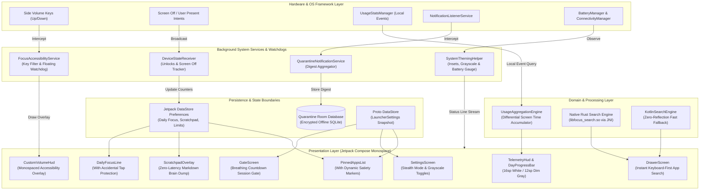

# FocusLauncher

<p align="center">
  <em>A zero-clutter, pure-black OLED minimalist Android launcher engineered to eliminate phone addiction through ambient accountability telemetry, finite day progress visualization, full gesture navigation, and hardware-level dopamine gating.</em>
</p>

<p align="center">
  
  
  
  
  
  
  
</p>

<p align="center">
  <a href="https://github.com/RayAashish/creativity-with-ai/releases/download/v2026.11.14/app-release.apk">
    
  </a>
  <a href="https://github.com/RayAashish/creativity-with-ai/releases/download/v2026.11.14/app-debug.apk">
    
  </a>
</p>

---

## Overview & Key Highlights

### Problem Statement
Modern smartphone home screens are dopamine-engineered casinos. Hyper-saturated app badges, unconstrained notification floods, infinite algorithmic feeds, and colorful notification drawers constantly hijack executive functioning. Existing "minimalist" launchers often make compromises: they still display bright system icons, rely on rigid text buttons, introduce heavy garbage-collection pauses during typing, or leak user telemetry to remote analytics endpoints.

### Core Value Proposition
**FocusLauncher** transforms your device into an intentional, silent utility tool:
- **100% Offline Architecture:** Absolutely zero internet permissions (`android.permission.INTERNET` is undeclared). No telemetry, no Firebase, no tracking pixels, zero analytics egress.
- **Pure OLED Black `#000000` Canvas:** Zero battery drain on modern OLED displays, maximum visual contrast, and custom monospaced typography (`FontFamily.Monospace`) across all screens.
- **Ambient Accountability Telemetry Engine:** Live on-device screen time differential accumulator, midnight-reset daily unlock counter, and offline streak tracker without battery-draining disk polling.
- **Dynamic Visual Satiety:** Pinned apps display live foreground usage tags and automatically dim by 55% with warning markers `[!]` when exceeding configured time caps.
- **Full-Screen Multi-Touch Gesture Canvas:** No on-screen buttons (`search`, `settings`, `scratch` removed). The entire display responds to intuitive swipes, double-taps, and edge interactions.
- **Hardware-Level OS Hooks:** Intercepts physical side volume keys (`KEYCODE_VOLUME_UP`/`DOWN`) to suppress colorful OEM volume sliders with a bespoke monospaced HUD, triggers system-wide hardware grayscale (Daltonizer), and features an in-app floating session pill.
- **Hybrid Rust NDK Search Engine:** Native Rust engine (`libfocus_search.so`) executing sub-millisecond app queries with automatic fallback to zero-reflection Kotlin search.

### Feature Matrix

| Feature | Capability & Implementation Details |
| :--- | :--- |
| **Ambient Telemetry HUD** | Live foreground aggregation via `UsageStatsManager.queryEvents()`, local ticker coroutines, daily unlock counter via `ACTION_USER_PRESENT`, and break duration tracker (`away Xh Ym`). |
| **Memento Mori Progress** | Monospaced 20-character ASCII day progress bar (`day [================--] 92%`), calculating elapsed minutes since midnight updating every 60 seconds. |
| **Single Focus Intent Line** | Clean `today's focus:` line with dedicated `[edit]` protection against accidental taps, inline `[save]` / `[esc]` triggers, and 04:00 AM daily auto-rollover via DataStore. |
| **Dynamic Satiety Pinning** | Up to 5 pinned essentials with dynamic usage duration tags (`· 38m`), opacity reduction to 45% upon crossing time limits, and custom time cap modals. |
| **Full Gesture Engine** | Swipe Up (Keyboard-first Drawer), Swipe Down (Zero-latency Scratchpad), Swipe Left (Settings), Double-Tap (Instant Screen Lock via Accessibility). |
| **Edge-to-Edge System Bar** | **Mode A (Stealth):** 100% hidden OS bars with transient swipe reveal. <br>**Mode B (Monospace Bar):** Custom top line `BATT 80% [====-] · WIFI ON · 10:07 PM`. |
| **Hardware Volume Key HUD** | Suppresses colorful OEM volume sliders via `FLAG_REQUEST_FILTER_KEY_EVENTS` in `FocusAccessibilityService` and draws bespoke monospaced `CustomVolumeHud` overlay. |
| **Hardware Daltonizer** | Toggles system-wide monochrome display across all apps via `WRITE_SECURE_SETTINGS` (`accessibility_display_daltonizer`). |
| **Intentional Launch Gate** | Enforces a mindful breathing countdown (5s/10s/15s) and strict session length (5m/10m/15m) before opening designated distracting packages. |
| **Quarantine Digest** | Intercepts non-essential notifications via `NotificationListenerService`, batching them into intentional digest windows (12:00, 18:00, 21:00) stored in Room. |

---

## System Architecture & Workflow

### High-Level Architecture Diagram



---

### Component Breakdown

#### 1. Presentation Layer (Jetpack Compose & Custom Gestures)
- **Lifecycle-Bound Recomposition Discipline:** Counters, clocks, and telemetry stats use `derivedStateOf`, `@Immutable` models, and dedicated ticker coroutines active only during `STARTED` / `RESUMED` states.
- **Custom Gesture Engine (`HomeGestureDetector.kt`):** A dual-pointer composite modifier using `detectTapGestures` and `detectDragGestures` with velocity and displacement thresholds to deliver button-free navigation.
- **Bespoke Window Management:** Enforces edge-to-edge window insets through `WindowInsetsControllerCompat`, with pure black backgrounds (`#000000`) and customizable system bar occlusion.

#### 2. Core Engine & Processing
- **Differential Screen-Time Accumulator (`UsageAggregationEngine.kt`):** Eliminates disk I/O bottlenecks by computing daily foreground durations using raw `UsageEvents` transformed into interval records, clamping orphaned sessions, and sustaining an in-memory 1-second ticker while the display is active.
- **Native Rust Search Engine (`native/focus_search/`):** Compiled with the Android NDK for `arm64-v8a`, `armeabi-v7a`, `x86`, and `x86_64`. Implements zero-allocation string normalization, prefix scoring, and substring matching accessed over high-throughput JNI.
- **Accidental Touch Filter (`DailyFocusLine.kt`):** Isolates the displayed focus goal from raw touch events; editing can only be triggered via a deliberate tap on the dimmed `[edit]` affordance or empty prompt.

#### 3. Data & I/O Boundaries
- **Jetpack DataStore (Preferences):** Persists `daily_focus_goal`, `focus_goal_timestamp` (with 04:00 AM daily rollover boundary detection), `scratchpad_content`, `custom_app_limits`, and telemetry streak metrics.
- **Proto DataStore (`LauncherSettings`):** Compact, binary-serialized settings storing gate delays, session caps, pinned app ordering, and package blacklist/whitelist sets.
- **Room SQLite Database (`QuarantineDatabase`):** Strictly offline storage for batched notifications, scheduled digest times, and unread notification queues.

---

## Project Structure

```text
anti-addication-launcher/
├── app/
│   ├── build.gradle.kts                # Build dependencies, NDK bindings, Compose BOM
│   ├── proguard-rules.pro              # R8 minification, keep rules for Protobuf & Room
│   └── src/
│       ├── main/
│       │   ├── AndroidManifest.xml     # Permissions, Accessibility & Notification services
│       │   ├── java/com/raysi/launcher/
│       │   │   ├── core/dispatchers/   # Coroutine dispatchers abstraction (Main, IO, Default)
│       │   │   ├── data/
│       │   │   │   ├── model/          # AppInfo, PinnedAppEntry, UsageEventRecord models
│       │   │   │   ├── proto/          # Protocol Buffer definitions and DataStore serializers
│       │   │   │   ├── quarantine/     # Room database, DAO, and entities for notification quarantine
│       │   │   │   ├── receiver/       # BroadcastReceiver for screen off and user unlock events
│       │   │   │   ├── repository/     # Telemetry, Preferences, Settings, Inventory repositories
│       │   │   │   ├── search/         # Kotlin and Rust NDK search engines
│       │   │   │   └── usage/          # UsageStats query engine and formatters
│       │   │   ├── di/                 # FocusLocator manual dependency injection (zero reflection)
│       │   │   ├── domain/model/       # UI state models (TelemetryUiState, DailyProgress, PinnedAppItem)
│       │   │   ├── service/            # FocusAccessibilityService, notification digest services
│       │   │   ├── ui/
│       │   │   │   ├── drawer/         # Keyboard-first app search drawer
│       │   │   │   ├── gate/           # Breathing countdown intentional launch screen
│       │   │   │   ├── gesture/        # HomeGestureDetector full-screen swipe & tap system
│       │   │   │   ├── home/           # Telemetry HUD, Memento Mori bar, focus line, pinned apps
│       │   │   │   ├── overlay/        # Monospaced CustomVolumeHud accessibility overlay
│       │   │   │   ├── quarantine/     # Scheduled notification digest UI
│       │   │   │   ├── scratchpad/     # Instant distraction-free scratchpad overlay
│       │   │   │   ├── settings/       # Stealth mode, hardware grayscale, app cap configuration
│       │   │   │   └── theme/          # Pure OLED black colors, monospace typography, theme wrappers
│       │   │   └── util/               # SystemThemingHelper, hardware Daltonizer, edge-to-edge
│       │   └── res/
│       │       ├── drawable/           # Adaptive focus logo (background, foreground, monochrome)
│       │       ├── mipmap-anydpi-v26/  # Adaptive app icons
│       │       └── xml/                # Accessibility service & file provider configs
│       └── test/java/com/raysi/launcher/ # Comprehensive JUnit unit tests for engines & ViewModels
├── native/
│   └── focus_search/                   # Native Rust crate for sub-millisecond JNI app search
│       ├── Cargo.toml
│       └── src/lib.rs
├── PRIVACY.md                          # Comprehensive privacy & zero-network policy
├── LICENSE                             # MIT License
├── build.gradle.kts                    # Root build configuration
└── settings.gradle.kts                 # Project and repository configuration
```

---

## Getting Started & Local Setup

### Prerequisites
- **Android Studio:** Ladybug (2024.2.1+) or newer
- **JDK:** OpenJDK 17 or 21
- **Android SDK:** Platforms 28 through 35 (Compiled against API 35 / Tested on API 36)
- **Android NDK:** Version `25.1.8937393` or higher (for Rust JNI compilation)
- **Rust Toolchain:** `1.75.0+` with target triples:
  ```bash
  rustup target add aarch64-linux-android armv7-linux-androideabi i686-linux-android x86_64-linux-android
  ```

### Installation & Run

1. **Clone the repository:**
   ```bash
   git clone https://github.com/RayAashish/creativity-with-ai.git
   cd creativity-with-ai/anti-addication-launcher
   ```

2. **Build the Debug APK:**
   ```bash
   ./gradlew assembleDebug
   ```

3. **Install on Connected Device via ADB:**
   ```bash
   adb install -r app/build/outputs/apk/debug/app-debug.apk
   ```

4. **Grant Optional System Privileges via ADB (One-time setup for hardware hooks):**
   ```bash
   # Grant local screen-time telemetry calculation
   adb shell appops set com.raysi.launcher android:get_usage_stats allow

   # Grant floating session watchdog pill permissions
   adb shell appops set com.raysi.launcher SYSTEM_ALERT_WINDOW allow

   # Grant hardware display Daltonizer (grayscale mode)
   adb shell pm grant com.raysi.launcher android.permission.WRITE_SECURE_SETTINGS
   ```

---

## Privacy, Permissions & Security

FocusLauncher is built on a non-negotiable **local-first, zero-surveillance** foundation:
- **No Internet Access:** `android.permission.INTERNET` is omitted from `AndroidManifest.xml`. The OS sandbox physically denies any socket connection, HTTP request, or external egress.
- **Local Analytics Only:** Daily screen times, unlock counts, and session metrics are calculated locally inside volatile memory and stored in encrypted-on-device Android DataStore.
- **Zero Accessibility Scraping:** `FocusAccessibilityService` only monitors package names of foreground transitions and key event codes (`KEYCODE_VOLUME_UP`/`DOWN`). It never inspects, captures, or reads on-screen text, form inputs, or window node content.
- **Clean Uninstallation:** Wiping or uninstalling the app permanently purges all local history, scratchpad notes, and telemetry caches.

---

## License & Attribution

Distributed under the **MIT License**. See [LICENSE](LICENSE) for full legal text.

Designed and engineered with intentionality by [Aashish Kumar Ray](https://github.com/RayAashish).
