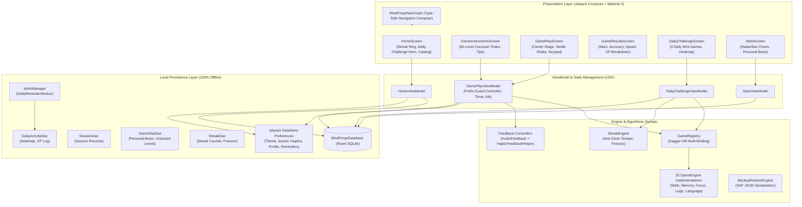

# MindForge

<p align="center">
  <em>A high-performance, offline-first cognitive training suite engineered with Kotlin & Jetpack Compose, featuring 25 specialized mini-games across 50 algorithmic levels with tactile haptic feedback.</em>
</p>

<p align="center">
  
  
  
  
  
  
</p>

<p align="center">
  <!-- PRIMARY ACTION BUTTONS -->
  <a href="https://github.com/RayAashish/creativity-with-ai/releases/download/v2026.11.14/MindForge-release.apk">
    
  </a>
  <a href="https://github.com/RayAashish/creativity-with-ai/releases/download/v2026.11.14/MindForge-debug.apk">
    
  </a>
</p>

---

## Overview & Key Highlights

### Problem Statement
Most modern brain-training applications are riddled with subscription paywalls, invasive tracking SDKs, mandatory cloud accounts, heavy server roundtrips, and bloated ad networks. For students, competitive-exam candidates, and professionals who want a rapid 2-minute daily mental warm-up, existing tools create friction, compromise privacy, and fail to work in airplane or low-connectivity environments.

### Core Value Proposition
**MindForge** is an uncompromised, native, 100% offline cognitive conditioning platform. Built with modern Android architecture guidelines (Kotlin 2.0, Jetpack Compose, Material 3, Room, DataStore, and Dagger Hilt), MindForge executes all question generation, evaluation, progression metrics, and streak tracking completely on-device.

- **Zero Network Footprint:** Omits `android.permission.INTERNET` entirely from `AndroidManifest.xml`.
- **Sub-Millisecond Latency:** Seeded algorithmic generators produce infinite non-repeating questions on-device with zero network wait states.
- **Matiks-Grade Tactile Input:** Custom numeric keypad with instant auto-submit, prefix-guarded multi-digit input, horizontal spring shake feedback, and multi-beat haptic buzzers.
- **50 Scaled Algorithmic Levels:** Data-driven progression per game (1,250 total level tiers) spanning basic arithmetic to chained BODMAS, spatial grid recall, N-back streams, and deductive matrices.
- **Air-Gapped Privacy & Portability:** Backup and restore your entire game history, activity heatmap, and badges using JSON via the Android Storage Access Framework (SAF).

### Feature Matrix

| Domain | Capabilities |
| :--- | :--- |
| **Mental Math (9 Games)** | Quick Calc, Speed Chain, Missing Element, Powers & Roots, Percent Sprint, True or False, Target 24, Number Sequence, and Offline Duel (local simulated AI bot). |
| **Memory (5 Games)** | Sequence Memory (Simon pattern), Card Match, Digit Span (forward/backward), Spatial Grid Recall, and continuous N-Back (1-back to 3-back). |
| **Focus & Speed (5 Games)** | Stroop Test (interference suppression), Schulte Grid, Odd One Out, Reaction Tap (millisecond motor response), and Go / No-Go inhibition. |
| **Logic & Deduction (4 Games)** | Pattern Matrix (3x3 Raven-style completion), Lights Out, Mini Sudoku (4x4 & 6x6 latin squares), and Balance Weights (inequality deduction). |
| **Language & Verbal (2 Games)** | Word Scramble (dictionary-backed anagrams) and Word Chain (shared syllable lexical linking). |
| **Tactile Keypad & Input** | Smart numeric keypad & 4-option grids; auto-submission on correct match; prefix-guard prevents typing errors; 350ms keyframe spring-shake on mistakes with auto-clear. |
| **Progression & Streaks** | 50 levels per game with 1–3 star ratings, player XP & level unlocks, anti-tamper streak engine, streak freeze protection, and 12-week activity calendar heatmap. |
| **Achievements & Badges** | 60+ offline achievements spanning milestones, category masteries, comeback feats, and perfect rounds. |
| **Preferences & Ergonomics** | System/Light/Dark theme, dynamic wallpaper color matching, adjustable haptic/sound toggles, offline WorkManager daily training reminder, and reduce-motion awareness. |

---

## System Architecture & Workflow

### High-Level Architecture Diagram



### Component Breakdown

#### ⚬ Presentation Layer
- **Framework:** 100% Jetpack Compose with Material 3 design tokens.
- **Navigation:** Modern `Navigation Compose 2.8+` with Kotlin serialization type-safe routes (`Screen.Home`, `Screen.GamePlay(gameId, level, isPractice)`, `Screen.GameResults(sessionId)`).
- **Motion & Polish:** Keyframe-driven spring shake (`shakeOffset.animateTo` with 350ms duration) on mistake inputs; color animation feedback (`animateColorAsState`) transitioning from error red to success green; circular streak rings and custom Compose Canvas calendar heatmaps.

#### ⚬ Core Engine / Processing
- **Game Engine Protocol:** Unified `GameEngine` interface enforcing `getLevelConfig(level: Int)`, `generateQuestion(level: Int, rng: Random, history: Set<String>)`, `evaluateAnswer(question, input)`, and `generatePracticeQuestions(rng)`.
- **Prefix Guard Typing Subsystem:** Evaluates numerical keypad entry sequentially. If `candidate.length < target.length`, input is recognized as in-flight and avoids premature error evaluation. Exact matches trigger zero-touch auto-submission. Over-length or non-matching submissions trigger haptic buzzers and automatic input clearing after 350ms.
- **Deterministic Deduplication:** Seeded RNG question generation cross-referenced against session history sets ensures zero question repetition within a training session.
- **Anti-Clock-Tamper Streak Engine:** Validates streak advancement using monotonic system clock (`SystemClock.elapsedRealtime()`) alongside local wall clock to prevent device time manipulation from forging fraudulent streaks.

#### ⚬ Data & I/O
- **Room Database (`MindForgeDatabase`):** On-device SQLite persistence storing `SessionEntity`, `GameStatEntity`, `StreakRecordEntity`, and `DailyActivityEntity` with database schema exports.
- **Jetpack DataStore:** Preferences storage using encrypted Protocol Buffer/Preferences DataStore for theme mode, dynamic color switches, haptic preferences, sound settings, profile avatars, and daily reminder times.
- **Storage Access Framework (SAF):** Full JSON import and export through Android's system document picker (`ACTION_CREATE_DOCUMENT` / `ACTION_OPEN_DOCUMENT`) for user-controlled cloud-free backups.

---

## Project Structure

```ascii
brain-games/
├── app/
│   ├── build.gradle.kts                # Android configuration (compileSdk 36, minSdk 26, R8/ProGuard)
│   ├── proguard-rules.pro              # Production code shrinking & Room/Serialization rules
│   ├── schemas/                        # Room schema JSON contracts (v1)
│   └── src/
│       ├── androidTest/                # Compose UI instrumented test suite
│       │   └── java/com/mindforge/app/GamePlayFlowTest.kt
│       ├── test/                       # Comprehensive JVM unit tests (Phases 0–5)
│       │   └── java/com/mindforge/app/
│       │       ├── Phase0Test.kt       # Theme, tokens, database schema validation
│       │       ├── Phase1Test.kt       # Room DAOs, entities, and DataStore tests
│       │       ├── Phase2Test.kt       # QuickCalc, SpeedChain, Prefix-Guard, 50-Level tests
│       │       ├── Phase3Test.kt       # Streak tamper engine, streak freezes, dates
│       │       ├── Phase4Test.kt       # All 25 Game Engines across 50 level configurations
│       │       ├── Phase5Test.kt       # 60+ Achievement definitions & JSON backup serialization
│       │       └── GameNavigationAndFlowTest.kt # Hilt GameRegistry & ViewModel tests
│       └── main/
│           ├── AndroidManifest.xml     # Application manifest (NO INTERNET PERMISSION)
│           ├── java/com/mindforge/app/
│           │   ├── MainActivity.kt     # Single-activity host with Edge-to-Edge & Compose content
│           │   ├── MindForgeApp.kt     # Application class initializing Hilt & WorkManager
│           │   ├── core/
│           │   │   ├── audio/          # SoundPool & AudioTrack tone feedback
│           │   │   ├── navigation/     # NavGraph & Type-Safe Screen route definitions
│           │   │   ├── reminder/       # Daily reminder WorkManager workers & schedulers
│           │   │   ├── theme/          # Custom brand tokens (Amber/Cyan), typography, spacing
│           │   │   └── ui/             # Reusable UI components (ActivityCalendarHeatmap, UserAvatar)
│           │   ├── data/
│           │   │   ├── di/             # Dagger Hilt modules (DatabaseModule, GameEngineModule)
│           │   │   ├── local/db/       # Room database, DAOs, entities, migrations
│           │   │   └── local/preferences/ # Jetpack DataStore UserPreferences repository
│           │   ├── domain/
│           │   │   ├── achievement/    # 60+ badge definitions and unlock engine
│           │   │   ├── backup/         # BackupRestoreEngine for SAF JSON imports/exports
│           │   │   └── streak/         # StreakEngine with monotonic clock tamper guards
│           │   └── feature/
│           │       ├── achievements/   # Badges screen with progress bars & filter chips
│           │       ├── challenge/      # Daily Challenge 3-game flow & claim reward logic
│           │       ├── game/
│           │       │   ├── framework/  # GameEngine, GameQuestion, GameRegistry interfaces
│           │       │   ├── focus/      # Stroop, Schulte, OddOneOut, ReactionTap, GoNoGo
│           │       │   ├── instructions/ # 50-level carousel, rules, tips screen
│           │       │   ├── language/   # WordScramble, WordChain engines
│           │       │   ├── logic/      # PatternMatrix, LightsOut, MiniSudoku, BalanceWeights
│           │       │   ├── math/       # QuickCalc, SpeedChain, MissingOperator, Powers, etc.
│           │       │   ├── memory/     # SequenceMemory, CardMatch, DigitSpan, SpatialGrid, NBack
│           │       │   ├── play/       # GamePlayScreen with keyframe shake, keypad, options
│           │       │   └── results/    # Star scoring, metrics breakdown, next level routing
│           │       ├── home/           # Dashboard with user greeting, streak ring, catalog
│           │       ├── onboarding/     # 3-step setup (intro, goal selection, profile)
│           │       ├── profile/        # Profile picture picker, initials avatar, name editor
│           │       ├── settings/       # Theme switch, audio/haptic toggles, backup/restore
│           │       └── stats/          # Category performance charts & personal bests
│           └── res/
│               ├── font/               # Bundled typography pair
│               ├── mipmap-*/           # Custom geometric launcher icons
│               └── values/             # Colors, strings, XML backup extraction rules
```

---

## Getting Started & Local Setup

### Prerequisites
- **JDK:** OpenJDK 17 or higher
- **Android SDK:** Compile SDK 36 (Android 16), Target SDK 36, Min SDK 26
- **Gradle:** 8.10.2+ (bundled via `./gradlew`)
- **Android Studio:** Ladybug (2024.2.1+) or newer

### Installation & Run

1. **Clone the Repository:**
   ```bash
   git clone https://github.com/RayAashish/creativity-with-ai.git
   cd creativity-with-ai/brain-games
   ```

2. **Run Unit Tests:**
   Execute the complete test suite across all 25 game engines, streak tamper algorithms, and database DAOs:
   ```bash
   ./gradlew testDebugUnitTest
   ```

3. **Compile Debug APK:**
   ```bash
   ./gradlew assembleDebug
   # Output binary located at: app/build/outputs/apk/debug/app-debug.apk
   ```

4. **Compile Production Release APK (Minified & Optimized via R8):**
   ```bash
   ./gradlew assembleRelease
   # Output binary located at: app/build/outputs/apk/release/app-release.apk
   ```

5. **Install on Connected Device via ADB:**
   ```bash
   adb install -r app/build/outputs/apk/release/app-release.apk
   adb shell am start -n com.mindforge.app.debug/com.mindforge.app.MainActivity
   ```

---

## Privacy, Permissions & Security

- **Strict Zero-Network Policy:** MindForge deliberately omits the `android.permission.INTERNET` permission from `AndroidManifest.xml`. The operating system guarantees that no network sockets can be opened, no telemetry can be transmitted, and no external code can be loaded.
- **Air-Gapped Data Storage:** All user statistics, session metrics, streak records, and profile details reside entirely within local SQLite (`MindForgeDatabase`) and Android DataStore inside the app's sandboxed private storage (`context.filesDir` / `databases`).
- **No Third-Party Analytics or Ad SDKs:** Zero Google Analytics, Firebase, Crashlytics, Facebook SDK, or advertising trackers are included in the dependency graph.
- **Scoped Storage & Photo Picker:** Profile avatar customization uses Android's modern Photo Picker (`ActivityResultContracts.PickVisualMedia`), eliminating the need for `READ_EXTERNAL_STORAGE` or `READ_MEDIA_IMAGES` permissions. Selected photos are cropped to ~512px and saved locally inside app-private internal files.
- **Optional Notification Permission:** `POST_NOTIFICATIONS` is only requested on Android 13+ (API 33+) if the user explicitly opts into the daily reminder timer within Settings.

---

## License & Attribution

Distributed under the **MIT License**. See `LICENSE` for more information.

Developed with precision and craft by [Aashish Kumar Ray](https://github.com/RayAashish).
