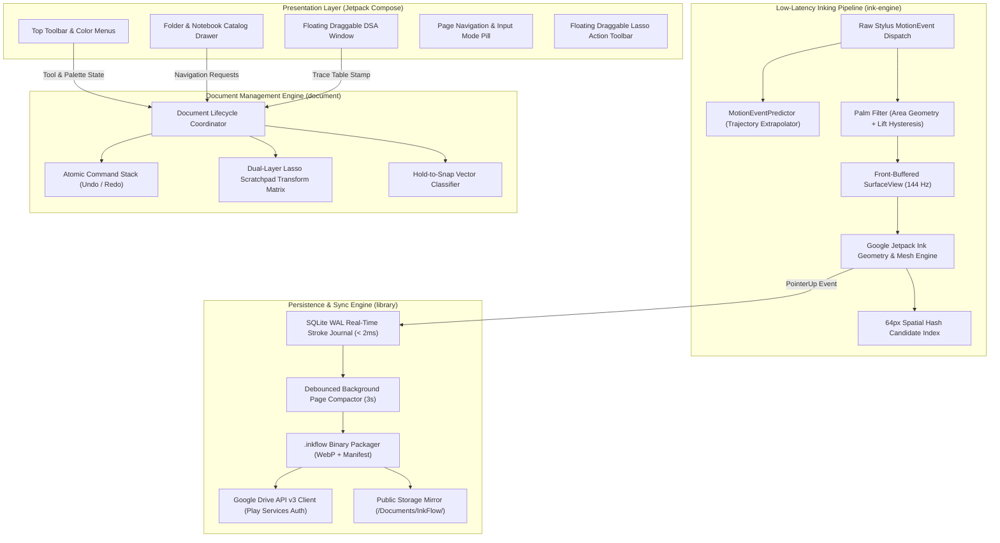

# InkFlow (Dream Note)

<p align="center">
  <em>A high-performance, native Android stylus note-taking engine engineered for near-zero latency (~1 ms @ 144 Hz) on Android tablets, featuring distraction-free DSA study workflows, instant stroke persistence, and zero-subscription data sovereignty.</em>
</p>

<p align="center">
  
  
  
  
  
  
  
</p>

<p align="center">
  <a href="https://github.com/RayAashish/creativity-with-ai/releases/download/v2026.11.14/app-debug.apk">
    
  </a>
  <a href="https://inkflow-reader.vercel.app">
    
  </a>
</p>

---

## Overview & Key Highlights

### Problem Statement
Standard digital stylus note-taking applications on Android suffer from three critical bottlenecks:
1. **The Inking Latency Myth:** Most apps run stylus input through standard Android View hierarchy redraw queues and VSYNC compositing, creating a 8–15 ms input lag that feels synthetic and disconnected from the physical stylus tip.
2. **Subscription Lock-in & Bloat:** Popular note tools impose \$10–\$15/month subscriptions, inject intrusive advertisements, or trap handwritten notes inside encrypted proprietary clouds with zero open interoperability.
3. **Engineering Workflow Friction:** Computer science and engineering students require simultaneous math grid drafting, code execution tracing, and real-time DSA problem solving without juggling disjointed multi-window desktop environments.

### Core Value Proposition
- **Near-Zero Latency (~1 ms @ 144 Hz):** Front-buffered native surface rendering (`GLFrontBufferedRenderer` / `CanvasFrontBufferedRenderer`) combined with Google Jetpack Ink (`androidx.ink`) and low-level hardware prediction (`MotionEventPredictor`) completely decouples stylus inking from Compose recomposition and VSYNC wait cycles.
- **Sub-20 ms Instant Page Load & Resumption:** Direct binary header indexing and lazy stroke parsing restore complex drawing canvases in under 12 ms, resuming precisely where you left off across app restarts.
- **Zero-Latency Real-Time Persistence (SQLite WAL):** Every pen lift appends stroke mutations to a high-speed SQLite Write-Ahead Log (WAL) off-thread in $< 2\text{ ms}$, ensuring zero data loss and crash immunity without inking frame drops.
- **100% Local-First & Cloud Interoperable:** Notes are stored locally as open `.inkflow` containers and mirrored to public document storage. Backups synchronize silently to user-owned Google Drive via Google Play Services Auth without third-party intermediary servers.

### Feature Matrix

| Capability | InkFlow Implementation | Technical Benefit |
| :--- | :--- | :--- |
| **Front-Buffered Inking** | `androidx.ink:ink-rendering` + `androidx.graphics` | Bypasses Android compositor queue; renders directly to hardware front-buffer in $< 1\text{ ms}$. |
| **Hardware Prediction** | `MotionEventPredictor` + unbuffered dispatch | Extrapolates stylus trajectory coordinates to match physical tip motion at 144 Hz. |
| **Partial / Segment Eraser** | Spatial hash grid (64px) + segment splitting | Erases precise stroke segments at 144 Hz; splits geometry cleanly with atomic single-swipe undo. |
| **Dual-Layer Lasso Engine** | Affine 2D matrix (`canvas.concat`) scratchpad | Decouples selected strokes onto hardware overlay; zero coordinate mutations or index rebuilds during drag. |
| **Smart Vector Shapes** | Hold-to-snap geometry recognizer | Snaps freehand circles, rectangles, lines, and arrows into vector shapes after brief stationary hold. |
| **Floating DSA Workspace** | Multi-source problem statement fetcher & HUD | Overlays LeetCode, Code360, GFG, Codeforces, and HackerRank problems with ghost mode and test case tracking. |
| **Dynamic Contrast Engine** | Bidirectional luminance adaptation | Flips black/white strokes cleanly between light/dark themes while strictly preserving chromatic highlighter hues. |
| **Image Ingestion** | Media Picker, Clipboard (`Ctrl+V`), Drag-and-Drop | Asynchronous off-thread decode, SHA-256 deduplicated WebP compression, and 4096px downsampling safety. |
| **Universal Sharing** | Standalone `.html` exports + Vercel Web Reader | Bundles self-contained vector renderer into exported files; inspectable in any browser without app installation. |
| **Google Drive Sync** | Native OAuth2 (`play-services-auth`) + Drive API v3 | Frictionless 1-tap Google Sign-In; streams ZIP backups to personal Drive with dirty-state change tracking. |

---

## System Architecture & Workflow

### High-Level Architecture Diagram



### Component Breakdown

#### Presentation Layer (`:app` & `:design-system`)
- **State Management:** Reactive unidirectional data flow (UDF) powered by Kotlin `StateFlow` and Jetpack Compose state holders. UI state is strictly decoupled from the real-time drawing loop to prevent recomposition overhead.
- **Gesture System:** Independent dispatch handlers for stylus touch events, multi-finger navigation (two-finger pan and pinch-to-zoom), and gesture-scoped palm rejection filters.
- **Floating DSA HUD:** Draggable, resizable overlay window with dual dark/light contrast typography, test-case tracking checkboxes, and direct web ingestion from competitive programming platforms.

#### Core Engine / Processing (`:ink-engine` & `:document`)
- **Native Ink Pipeline:** Integrates Google's `androidx.ink` suite for stroke modeling, pressure-to-brush-width mapping, and hardware-accelerated OpenGL/Canvas front-buffering.
- **Spatial Hashing Index:** 64-pixel uniform spatial grid indexing provides sub-millisecond candidate lookup for partial stroke segment intersections and lasso bounding box queries.
- **Dual-Layer Scratchpad Architecture:** Isolates selected lasso strokes onto an interactive hardware overlay layer driven by a 2D affine transform matrix (`canvas.concat`), eliminating coordinate mutations and spatial index rebuilds during continuous dragging.
- **Shape Recognition:** Geometry classifier analyzes stroke curvature and closure, snapping rough freehand shapes (circles, ellipses, rectangles, lines, arrows) into crisp vector primitives upon a momentary stationary hold.

#### Data & I/O (`:library`)
- **SQLite WAL Real-Time Journal:** Employs SQLite configured with Write-Ahead Logging (`PRAGMA journal_mode = WAL; PRAGMA synchronous = NORMAL;`). Every stroke completion appends a binary record in $< 2\text{ ms}$ on `Dispatchers.IO`, immune to unexpected process exits.
- **Debounced Page Compactor:** Coroutine-driven background worker coalesces accumulated journal records into canonical `.inkflow` container files every 3 seconds and clears compacted journal rows.
- **Deduplicated Asset Vault:** Images are compressed off-thread into WebP format with SHA-256 cryptographic content addressing, guaranteeing zero duplicate asset storage across pages.
- **Google Drive API v3 Sync:** Direct streaming over `multipart/related` REST endpoints authenticated through Google Play Services (`play-services-auth`), featuring SHA-256 integrity validation and conflict-free restore staging.

---

## Project Structure

```text
dream-note-taking-app/
├── app/                                # Application Entry Point & Primary UI
│   ├── build.gradle.kts                # Android application configuration
│   └── src/main/java/com/antigravity/note/
│       ├── MainActivity.kt             # Main Activity, window insets, session restore
│       ├── DreamNoteApplication.kt     # App-level dependency initialization
│       └── ui/
│           ├── canvas/                 # Low-latency canvas Compose host & controls
│           ├── dsa/                    # Floating DSA problem window & problem scrapers
│           ├── library/                # Hierarchical notebook/folder explorer drawer
│           ├── backup/                 # Google Drive sync dialog & account picker
│           ├── lasso/                  # Floating lasso action toolbar & recolor UI
│           ├── shapes/                 # Shape recognition feedback overlays
│           └── probe/                  # Hardware digitizer & refresh rate diagnostic screen
├── ink-engine/                         # Low-Latency Stylus & Inking Core Engine
│   ├── build.gradle.kts                # Native inking dependencies (androidx.ink)
│   └── src/main/java/com/antigravity/note/inkengine/
│       ├── canvas/                     # Front-buffered SurfaceView & render loop
│       ├── eraser/                     # 144 Hz partial segment eraser & spatial index
│       ├── lasso/                      # Dual-layer scratchpad affine transform matrix
│       ├── palm/                       # Palm rejection heuristics & lift hysteresis
│       ├── shape/                      # Freehand-to-vector shape recognizer
│       └── probe/                      # Hardware touch axes & motion prediction probe
├── document/                           # Document Model & Stroke Serialization
│   ├── build.gradle.kts                # Document domain configuration
│   └── src/main/java/com/antigravity/note/document/
│       ├── model/                      # Immutable Stroke, Page, and Document entities
│       ├── storage/                    # Binary page serialization & lazy stroke parser
│       ├── manager/                    # Document lifecycle, active page, undo/redo stack
│       └── export/                     # Self-contained HTML & vector export generators
├── library/                            # Persistence, Database, and Cloud Sync
│   ├── build.gradle.kts                # Room, KSP, SQLite, and Google API dependencies
│   └── src/main/java/com/antigravity/note/library/
│       ├── db/                         # Room SQLite database & FTS5 full-text search
│       ├── journal/                    # Sub-2ms SQLite WAL real-time stroke persistence
│       ├── repository/                 # Subject, notebook, and page repository contracts
│       └── backup/                     # Google Drive v3 REST engine & SAF local mirror
├── design-system/                      # Design Tokens, Theming, and Visual Primitives
│   └── src/main/java/com/antigravity/note/designsystem/
│       ├── theme/                      # Dynamic contrast palettes, dark/light themes
│       └── components/                 # Glassmorphic controls, icons, and dialogs
├── web-viewer/                         # Cross-Platform Web Reader
│   └── index.html                      # Standalone zero-dependency HTML5 vector reader
├── docs/                               # Engineering Documentation & Benchmark Reports
│   ├── FORMAT.md                       # .inkflow binary file format specification
│   ├── PERFORMANCE.md                  # 144 Hz frame budget analysis & JNI metrics
│   └── backup-design.md                # Cloud sync & restore staging protocol
├── .env.example                        # Template for optional OAuth overrides
└── LICENSE                             # Open-source MIT License
```

---

## Getting Started & Local Setup

### Prerequisites
- **Operating System:** macOS, Linux, or Windows (WSL2 recommended)
- **Java Development Kit (JDK):** OpenJDK 17 or higher
- **Android Studio:** Ladybug (2024.2.1) or newer
- **Android SDK:** API 34+ (Android 14) platform and build-tools
- **Target Hardware (Recommended):** Android tablet equipped with an active digitizer and 120 Hz / 144 Hz refresh rate (e.g., Motorola Moto Pad 70 Pro with Moto Pen Pro, Samsung Galaxy Tab S8/S9, Xiaomi Pad 6).

### Installation & Run

1. **Clone the repository:**
   ```bash
   git clone https://github.com/RayAashish/creativity-with-ai.git
   cd creativity-with-ai/dream-note-taking-app
   ```

2. **Environment configuration:**
   ```bash
   cp .env.example .env
   ```
   *(Optional: configure custom OAuth client parameters or keep default native Google Play Services integration).*

3. **Compile Kotlin sources and dependencies:**
   ```bash
   ./gradlew compileDebugKotlin
   ```

4. **Assemble Debug APK:**
   ```bash
   ./gradlew assembleDebug
   ```

5. **Install to connected physical tablet or emulator via ADB:**
   ```bash
   adb install -r app/build/outputs/apk/debug/app-debug.apk
   ```

6. **Launch application:**
   ```bash
   adb shell monkey -p com.antigravity.note -c android.intent.category.LAUNCHER 1
   ```

---

## Privacy, Permissions & Security

- **100% On-Device Local-First Architecture:** InkFlow processes and stores all notes, strokes, and images on the device filesystem. There are no proprietary backend servers, telemetry trackers, or external analytics SDKs integrated into the codebase.
- **Scoped Storage & User Sovereignty:** All document archives are packaged using standard ZIP/WebP formats in app-private storage, with an automatic mirror stored to user-visible storage (`/storage/emulated/0/Documents/InkFlow/`). Notes remain accessible even if the app is uninstalled.
- **Explicit Cloud Sync Scope:** Cloud backup connects directly from your device to your personal Google Drive account using Google's sanctioned `https://www.googleapis.com/auth/drive.file` scope. The app only accesses files and folders it explicitly creates (`inkflow_vault_backup.zip`).
- **Encrypted Local Credentials:** When custom OAuth refresh tokens are stored locally, they are protected inside Android's EncryptedSharedPreferences backed by hardware Keystore keys (AES-256 GCM).

---

## License & Attribution

This project is licensed under the **[MIT License](LICENSE)**. You are free to use, modify, distribute, and integrate this software into educational, personal, or commercial systems.

```text
MIT License
Copyright (c) 2026 Aashish Kumar Ray
```

*Built with passion for engineers, students, and makers who demand uncompromising tactile speed.*
