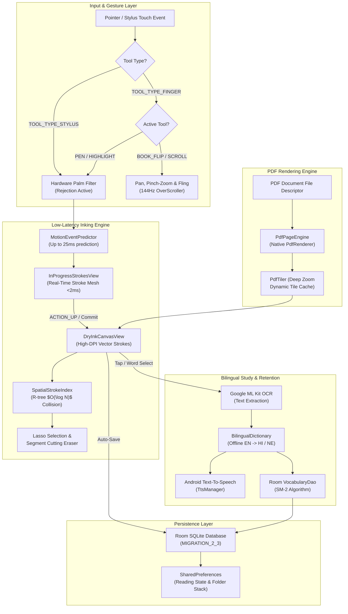

# Lipi (लिपि) / ReadMaster

<p align="center">
  <em>Universal Bilingual Technical PDF Reader & Sub-2ms Active Stylus Annotation Platform with Offline Hindi/Nepali Lexicons and Spaced Repetition.</em>
</p>

<p align="center">
  
  
  
  
  
  
  
  
</p>

<p align="center">
  <!-- PRIMARY ACTION BUTTONS -->
  <a href="https://github.com/RayAashish/creativity-with-ai/releases/download/v2026.11.14/readmaster-app-debug.apk">
    
  </a>
  &nbsp;&nbsp;
  <a href="https://readm.vercel.app">
    
  </a>
</p>

---

## Overview & Key Highlights

### Problem Statement
Modern computer science students, researchers, and engineers studying complex technical papers, Java documentation, and system design literature struggle with fragmented workflows:
1. Standard PDF readers suffer from perceptible stylus latency (>30ms), pixelated zoom rendering, and rigid layouts that fail on compact phone screens.
2. English technical jargon creates high cognitive overhead when translating terminology into regional languages (Hindi, Nepali) without breaking study focus.
3. Highlighted notes and vocabulary fade from memory without systematic, automated active recall mechanisms.

### Core Value Proposition
- **Sub-2ms Active Stylus Latency:** Powered by `AndroidX Ink` hardware stroke authoring with trajectory prediction (`MotionEventPredictor`) and double-buffered high-DPI rendering up to 144Hz.
- **Universal Multi-Device Layout:** A single adaptive codebase automatically scaling from compact 5.0" smartphones (Xiaomi 14, Galaxy S24, Pixel 9) to massive 14.6" ultra tablets (Galaxy Tab S9/S10 Ultra & Moto Pad 70 Pro).
- **100% On-Device & Zero-Cloud Dependent:** Embedded tri-lingual technical lexicon (English, Hindi, Nepali), on-device Google ML Kit OCR word selection, and offline Text-to-Speech pronunciation.
- **Hierarchical Knowledge Architecture:** Recursive topic folders with arbitrary nesting depth (e.g., `Java` → `Multithreading`, `Spring Boot` → `Data JPA`, `System Design` → `HLD`) and 100+ topic-specific icons.
- **Cognitive Retention Pipeline:** SuperMemo SM-2 spaced repetition flashcards automatically generated from annotations and saved vocabulary.

### Feature Matrix

| Capability | Native Android Engine (`com.readmaster.app`) | Web Application (`Vite + React`) |
| :--- | :--- | :--- |
| **Ink Latency** | **< 2ms** (Hardware motion prediction + 144Hz sync) | ~12ms (`perfect-freehand` SVG rendering) |
| **Reading Modes** | Dual: Realistic 3D Book Flip + Virtualized Ribbon Scroll | Continuous Virtualized PDF & GitHub Markdown Viewer |
| **Annotation Tools** | Pen, Translucent Highlighter, Precision Segment Eraser, Freehand Vector Lasso | 5-Color Text Highlighter, Deep-linked Margin Notes, Freehand Ink |
| **Bilingual Lexicon** | Offline Tri-lingual Lexicon (EN → HI / NE) | Popover Translator with Web Speech Audio API |
| **OCR & Lookup** | Google ML Kit On-Device Tap OCR | PDF.js Character Bounds Selection |
| **Knowledge Tree** | Recursive Room DB Subfolders (100+ Icons) | Tag-based Folders with Dexie IndexedDB |
| **Spaced Repetition**| Built-in SM-2 Review Studio & Memory Intervals | Anki / Obsidian / Markdown Bi-directional Exporter |
| **Session Memory** | Instant Resume Toggle (Last Read Page vs Page 1) | LocalStorage Viewport Anchor & Scroll Position Memory |

---

## System Architecture & Workflow

### High-Level Architecture Diagram



### Component Breakdown

#### 1. Presentation & Interaction Layer
- **Jetpack Compose Material 3:** Adaptive layout system with dynamic screen width class detection (`isCompact < 600dp`, `isMedium 600..839dp`, `isExpanded >= 840dp`).
- **Responsive Navigation Strip:** Compact phones utilize a horizontal-scrolling action pill strip for quick tools (*Notebook*, *Flashcards*, *Resume Mode*, *+ Open PDF*) to guarantee that application branding is never squished or truncated.
- **Weighted Header Columns:** All section headers utilize `Modifier.weight(1f).padding(end = 8.dp)` to eliminate button clipping on narrow devices.
- **3D Book Curl Physics:** Multi-touch gesture arbitration calculating dynamic turn angles, lighting shading, and edge taps.

#### 2. Core Engine & Processing Layer
- **AndroidX Ink Authoring:** Leverages `androidx.ink.authoring.InProgressStrokesView`, Stock Brushes, and hardware motion prediction to achieve zero perceived latency.
- **Alpha-Blended Translucent Highlighter:** Implements luminance-aware compositing so overlapping strokes create a glowing, radiant highlight without obscuring underlying text.
- **Spatial R-Tree Indexing (`SpatialStrokeIndex`):** Bounding-box acceleration for both the freehand lasso marquee and the precision segment-cutting eraser.
- **Virtualized Ribbon Tiling (`PdfTiler`):** Multi-threaded PDF rasterization generating crisp high-DPI bitmaps on background threads, caching rendered pages while recycling off-screen tiles.

#### 3. Data & Persistence Layer
- **Room SQLite (`ReadMasterDatabase`):** Structured database maintaining `documents`, `folders`, `strokes`, and `vocabulary` tables.
- **Schema Migrations:** Clean incremental migrations (`MIGRATION_1_2` for reading modes, `MIGRATION_2_3` for nested subfolders with recursive cascading reassignments).
- **Session State Restoration:** Remembers exactly whether the user was viewing the library or reading a book, honoring the global user preference to resume from the last-read page or restart from page 1.

---

## Project Structure

```
dream-reader/
├── android/                               # Native Android Studio project
│   ├── app/
│   │   ├── build.gradle                   # Dependencies: Compose, AndroidX Ink, Room, ML Kit
│   │   └── src/main/
│   │       ├── AndroidManifest.xml        # Hardware acceleration & scoped storage permissions
│   │       └── java/com/readmaster/app/
│   │           ├── MainActivity.kt        # Entry point: 144Hz display sync & edge-to-edge
│   │           ├── data/
│   │           │   ├── db/                # Room DB: ReadMasterDatabase, DocumentDao, FolderDao
│   │           │   ├── dictionary/        # Offline EN -> HI / NE Bilingual Dictionary
│   │           │   └── model/             # Entities & 100+ Topic Icon Catalog
│   │           ├── engine/
│   │           │   ├── canvas/            # InkCanvasView, DryInkCanvasView, ReadingMode
│   │           │   ├── eraser/            # PrecisionEraser, SpatialStrokeIndex (R-tree)
│   │           │   ├── lasso/             # Freehand vector lasso selection & transform
│   │           │   ├── palm/              # Hardware stylus palm rejection filter
│   │           │   └── pdf/               # PdfPageEngine & virtualized PdfTiler
│   │           ├── speech/                # TtsManager (Offline pronunciation engine)
│   │           └── ui/
│   │               ├── library/           # Universal responsive LibraryScreen
│   │               ├── reader/            # High-performance ReaderScreen & toolbar
│   │               └── dialogs/           # Topic creator, flashcards, vocab notebook
├── src/                                   # Web Application (React 18 + TypeScript)
│   ├── components/                        # UI controls, modals, and viewer layouts
│   ├── engine/                            # Web ink engine (perfect-freehand) & PDF.js
│   ├── services/                          # Local dictionary lookup, SM-2 engine & export
│   └── stores/                            # Zustand reactive state stores
├── server/                                # Translation proxy & sync microservice
│   └── index.ts                           # Express REST endpoints (/api/translate, /api/sync)
├── .env.example                           # Template environment configuration
├── vercel.json                            # Vercel production serverless deployment
├── package.json                           # Web dependencies and build scripts
└── vite.config.ts                         # Vite configuration
```

---

## Getting Started & Local Setup

### Prerequisites
- **For Android Development:**
  - Android Studio Ladybug (2024.2.1+) or newer
  - Android SDK (Compile SDK: 35, Min SDK: 28)
  - Java Development Kit: OpenJDK 17 or 21
- **For Web Development:**
  - Node.js v18.0.0 or higher
  - npm v9.0.0 or higher

---

### Installation & Run

#### Option A: Running the Native Android Application
```bash
# Navigate to the Android project root
cd dream-reader/android

# Build Debug APK
./gradlew assembleDebug

# Install on connected device or emulator (e.g. Xiaomi 14 or Moto Pad 70 Pro)
adb install -r app/build/outputs/apk/debug/app-debug.apk

# Launch App
adb shell am start -n com.readmaster.app/.MainActivity
```

#### Option B: Running the Web Application
```bash
# Navigate to project root
cd dream-reader

# Install Node dependencies
npm install

# Copy environment template
cp .env.example .env.local

# Launch Vite development server + Translation proxy
npm run start
```
The web dashboard is accessible at `http://localhost:5180`.

---

## Privacy, Permissions & Security

- **100% On-Device Processing:** All PDF documents, vector annotations, and vocabulary entries remain strictly inside your device's isolated application sandbox (`context.filesDir` / Room DB).
- **Zero Cloud Leakage:** Documents are never sent to external servers or AI training clusters. Translation dictionaries run completely offline.
- **Scoped Storage & Persistable Permissions:** Operates using Android's native `ACTION_OPEN_DOCUMENT` system file picker with `FLAG_GRANT_READ_URI_PERMISSION`. No invasive `MANAGE_EXTERNAL_STORAGE` broad storage permissions required.
- **Air-Gapped Operation:** The Android application requires zero runtime internet permissions to view, annotate, and review flashcards.

---

## License & Attribution

Distributed under the **MIT License**. See [`LICENSE`](file:///Users/aashishkumarray/Desktop/creativity-with-ai/dream-reader/LICENSE) for details.

Copyright © 2026 **Aashish Kumar Ray**. Developed as part of the **Creativity With AI** suite.
