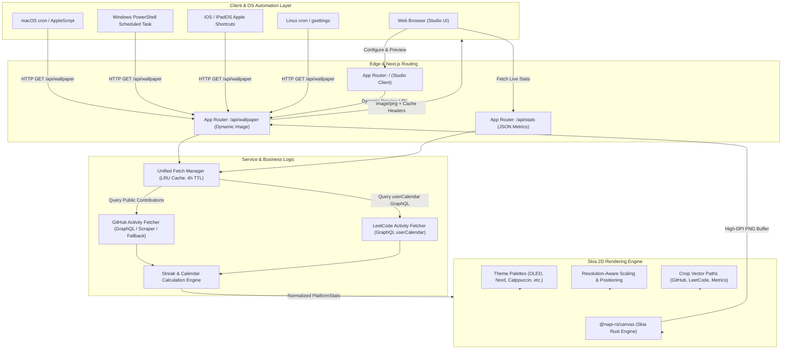

# StreakPaper

<p align="center">
  <em>Turn developer streaks and activity heatmaps into resolution-aware aesthetic desktop and mobile wallpapers with automated daily background sync.</em>
</p>

<p align="center">
  
  
  
  
  
  
  
  
</p>

<p align="center">
  <a href="https://streakpaper.vercel.app">
    
  </a>
</p>

---

## Overview & Key Highlights

### Problem Statement
Developers take immense pride in their coding consistency, contribution graphs, and algorithm problem-solving streaks across platforms like **GitHub** and **LeetCode**. However, these accomplishments remain sequestered behind web browsers and profile pages. Setting static screenshots as desktop wallpapers is tedious, rapidly becomes obsolete, and produces blurry, distorted images when stretched across varying monitor resolutions (from 1080p and ultrawide screens to high-DPI 4K and mobile aspect ratios).

### Core Value Proposition
**StreakPaper** bridges developer dedication and desktop aesthetics:
- **Zero Authentication Friction:** Queries public contribution graphs and GraphQL calendars without demanding user OAuth credentials, access tokens, or personal account sign-ins.
- **Dynamic Persistent API (`/api/wallpaper`):** Acts as a live image server that fetches fresh activity data and renders a pixel-perfect, high-DPI wallpaper on the fly whenever requested by OS automation scripts.
- **Hardware-Accelerated Serverless Skia Rendering:** Powered by native `@napi-rs/canvas` (Rust-backed Skia 2D engine) to render 4K (3840×2160) wallpapers in under 200ms with vector icons, ambient radial glow gradients, and customizable coordinates.
- **OS-Native Automation:** Includes 1-click copyable scripts for **macOS** (`cron` + `osascript`), **Windows** (PowerShell Scheduled Tasks), **iOS / iPadOS** (Apple Shortcuts automation), and **Linux** (`cron` + `gsettings`/`feh`).

### Feature Matrix

| Feature | Details |
| :--- | :--- |
| **Data Sources** | Public GitHub contribution graph (GraphQL API + scraping fallback) & LeetCode GraphQL `userCalendar` |
| **Rendering Engine** | Native `@napi-rs/canvas` (Skia 2D) with resolution-independent vector paths and proportional scaling |
| **Aesthetic Themes** | *OLED True Black*, *Catppuccin Mocha*, *Nord Frost*, *Dracula Vampire*, *Tokyo Night*, *Cyberpunk 2077*, *Solarized Dark*, *Forest Minimal* |
| **Widget Placement** | `center`, `bottom-right` (leaves desktop icons clear), `top-center` (macOS Dock / Windows taskbar friendly), `minimal` (compact 3-month widget) |
| **Resolution Support** | Standard 1080p, 2K QHD (1440p), 4K UHD (2160p), Ultrawide (21:9 3440×1440), MacBook Pro Retina, Android (1080×2400), iPhone Pro (1179×2556), and custom W×H |
| **Performance & Caching**| Dual-tier caching with in-memory LRU Cache (4-hour TTL) and HTTP Edge `Cache-Control` (`stale-while-revalidate=86400`) |
| **Interactive Studio** | Live aspect-ratio-accurate canvas simulation, mock desktop icon overlay, mock macOS dock preview, 1-click screen detection |

---

## System Architecture & Workflow

### High-Level Architecture Diagram



---

### Component Breakdown

#### ⚬ Presentation Layer
- **Interactive Web Studio (`src/components/Studio.tsx`):**
  - Built with React 19, TypeScript, and Tailwind CSS v4.
  - Controls for multi-platform handles, resolution presets, theme swatches, widget placements, and visual toggles (ambient neon glow, coordinate grid, metric chips).
  - Screen auto-detection using `window.screen.width * window.devicePixelRatio` to calibrate native monitor resolutions.
  - Scale-to-fit canvas simulation reflecting actual screen aspect ratios with optional mock desktop overlays (desktop folders/shortcuts or macOS Dock) to verify placement readability.
- **Automation Modal (`src/components/AutomationModal.tsx`):**
  - OS-specific copyable automation scripts for macOS, Windows, iOS, and Linux with the active dynamic API URL baked in.

#### ⚬ Core Engine & Processing
- **Dynamic Canvas Engine (`src/lib/renderer/wallpaper.ts`):**
  - Powered by `@napi-rs/canvas` using native Skia 2D vector drawing.
  - Resolution-independent proportional scaling (`scale = min(width / 1920, height / 1080)` for desktop; responsive column compression for portrait mobile aspect ratios).
  - Native `Path2D` vector rendering for official GitHub Octocat and LeetCode branding.
  - Glassmorphic card styling, subtle radial glow gradients, coordinate dot grids, and 5-level contribution heat maps.
- **Streak Calculation Logic (`src/lib/streaks.ts`):**
  - Chronological matrix verification tracking current streaks (accommodating today's activity in progress), all-time longest streaks, total active days, and cumulative contributions.
  - Deterministic pseudo-random mock calendar generator for offline testing and preview fallbacks.

#### ⚬ Data & I/O
- **GitHub Fetcher (`src/lib/fetchers/github.ts`):**
  - Three-tier resilient fetching strategy: official GraphQL API (if optional `GITHUB_TOKEN` is present) &rarr; public aggregator API &rarr; public SVG/HTML scraper fallback &rarr; graceful mock fallback.
- **LeetCode Fetcher (`src/lib/fetchers/leetcode.ts`):**
  - Queries `https://leetcode.com/graphql` for `userCalendar` and user profile avatars, decoding epoch timestamp submission dictionaries into 365-day arrays.
- **Cache Management (`src/lib/fetchers/index.ts`):**
  - In-memory `LRUCache` storing normalized `PlatformStats` for 4 hours (up to 500 entries) to prevent API rate-limiting.
- **Dynamic API Route (`src/app/api/wallpaper/route.ts`):**
  - Validates query parameters with **Zod** (`github`, `leetcode`, `theme`, `w`, `h`, `pos`, `glow`, `grid`, `stats`, `download`, `nocache`).
  - Emits binary `image/png` streams with HTTP cache headers (`public, max-age=14400, stale-while-revalidate=86400`).

---

### Project Structure

```text
dream-wallpaper/
├── .env.example                  # Environment configuration template
├── .gitignore                    # Git exclusion rules for artifacts & secrets
├── LICENSE                       # MIT License
├── README.md                     # Architectural documentation
├── next.config.ts                # Next.js 16 configuration with Skia external packaging
├── package.json                  # Dependencies and build scripts
├── package-lock.json             # Pinned dependency lockfile
├── tsconfig.json                 # TypeScript strict compiler configuration
├── public/                       # Static public assets & icons
│   ├── favicon.ico
│   ├── file.svg
│   ├── globe.svg
│   ├── next.svg
│   ├── vercel.svg
│   └── window.svg
└── src/
    ├── app/
    │   ├── api/
    │   │   ├── stats/            # JSON endpoint returning normalized user stats
    │   │   │   └── route.ts
    │   │   └── wallpaper/        # Dynamic wallpaper image generation endpoint
    │   │       └── route.ts
    │   ├── favicon.ico
    │   ├── globals.css           # Tailwind CSS v4 styling & dark theme scrollbars
    │   ├── layout.tsx            # Root HTML layout & font definitions
    │   └── page.tsx              # Application entry point mounting Studio
    ├── components/
    │   ├── AutomationModal.tsx   # Modal with OS automation scripts (macOS/Win/iOS/Linux)
    │   └── Studio.tsx            # Interactive Web Studio & live canvas simulation
    ├── lib/
    │   ├── fetchers/             # Platform data retrieval modules
    │   │   ├── github.ts         # GitHub GraphQL & scraping fetcher
    │   │   ├── index.ts          # Unified multi-platform fetcher with LRU cache
    │   │   └── leetcode.ts       # LeetCode GraphQL userCalendar fetcher
    │   ├── renderer/
    │   │   └── wallpaper.ts      # Hardware-accelerated Skia 2D wallpaper renderer
    │   ├── streaks.ts            # Streak calculation algorithms & mock calendar generator
    │   └── themes.ts             # Curated color palettes & theme definitions
    └── types/
        └── wallpaper.ts          # Shared TypeScript interfaces & types
```

---

## Getting Started & Local Setup

### Prerequisites
- **Node.js:** `v20.0.0` or higher (tested on `v24.10.0`).
- **npm:** `v10.0.0` or higher.
- **Operating System:** macOS (Apple Silicon / Intel), Linux (x64 / arm64), or Windows (x64).

### Installation & Run

1. **Clone the repository:**
   ```bash
   git clone https://github.com/RayAashish/creativity-with-ai.git
   cd creativity-with-ai/dream-wallpaper
   ```

2. **Install dependencies:**
   ```bash
   npm install
   ```

3. **Configure Environment (Optional):**
   ```bash
   cp .env.example .env.local
   ```
   *(Optional: Add a `GITHUB_TOKEN` to increase GitHub GraphQL API rate limits; the app functions fully without it using public scrapers).*

4. **Start the local development server:**
   ```bash
   npm run dev
   ```

5. **Open in browser:**
   Visit [http://localhost:3000](http://localhost:3000) to access the Interactive Studio.

6. **Create a production build:**
   ```bash
   npm run build
   npm run start
   ```

---

## Dynamic API Reference

### `GET /api/wallpaper`

Returns a high-definition, dynamically rendered PNG wallpaper image.

#### Query Parameters:

| Parameter | Type | Default | Description |
| :--- | :--- | :--- | :--- |
| `github` | `string` | `torvalds` | Public GitHub username |
| `leetcode` | `string` | `""` | Public LeetCode username |
| `theme` | `string` | `oled` | `oled`, `catppuccin`, `nord`, `dracula`, `tokyo-night`, `cyberpunk`, `solarized`, `forest` |
| `w` or `width` | `number` | `1920` | Output width in pixels (`320` to `7680`) |
| `h` or `height` | `number` | `1080` | Output height in pixels (`240` to `4320`) |
| `pos` or `position`| `string` | `center` | `center`, `bottom-right`, `top-center`, `minimal` |
| `glow` | `string` | `1` | Toggle ambient radial neon glow (`1` or `0`) |
| `grid` | `string` | `1` | Toggle coordinate background dot grid (`1` or `0`) |
| `stats` | `string` | `1` | Toggle streak summary metric chips (`1` or `0`) |
| `download` | `string` | `0` | If `1`, sets `Content-Disposition: attachment` for direct download |
| `nocache` | `string` | `0` | If `1`, bypasses server LRU cache for live testing |

#### Example Usage:
```http
GET https://streakpaper.vercel.app/api/wallpaper?github=torvalds&leetcode=lee215&theme=nord&w=2560&h=1440&pos=bottom-right
```

---

## OS Automation Setup

### 1. macOS (Cron + AppleScript)
Create a daily update script in `~/.streakpaper/update.sh`:
```bash
#!/usr/bin/env bash
mkdir -p "$HOME/.streakpaper"
WALLPAPER="$HOME/.streakpaper/wallpaper.png"

curl -s -L "https://streakpaper.vercel.app/api/wallpaper?github=YOUR_HANDLE&theme=oled&w=2560&h=1440" -o "$WALLPAPER"
osascript -e 'tell application "System Events" to set picture of every desktop to POSIX file "'$WALLPAPER'"'
```
Schedule it to run daily at 8:00 AM:
```bash
(crontab -l 2>/dev/null; echo "0 8 * * * ~/.streakpaper/update.sh >/dev/null 2>&1") | crontab -
```

### 2. Windows (PowerShell Scheduled Task)
Save to `$HOME\.streakpaper\update.ps1`:
```powershell
$folder = "$HOME\.streakpaper"
New-Item -ItemType Directory -Force -Path $folder | Out-Null
$wallpaperPath = "$folder\wallpaper.png"
Invoke-WebRequest -Uri "https://streakpaper.vercel.app/api/wallpaper?github=YOUR_HANDLE&theme=oled&w=1920&h=1080" -OutFile $wallpaperPath

$code = @'
using System.Runtime.InteropServices;
public class Wallpaper {
    [DllImport("user32.dll", CharSet = CharSet.Auto)]
    public static extern int SystemParametersInfo(int uAction, int uParam, string lpvParam, int fuWinIni);
}
'@
Add-Type -TypeDefinition $code
[Wallpaper]::SystemParametersInfo(0x0014, 0, $wallpaperPath, 0x01 -bor 0x02)
```
Register the task:
```powershell
$Action = New-ScheduledTaskAction -Execute 'powershell.exe' -Argument '-ExecutionPolicy Bypass -File "$HOME\.streakpaper\update.ps1"'
$Trigger = New-ScheduledTaskTrigger -Daily -At 8am
Register-ScheduledTask -Action $Action -Trigger $Trigger -TaskName "StreakPaperSync"
```

### 3. iOS / iPadOS (Apple Shortcuts)
1. Open the **Shortcuts** app on iOS.
2. Create a new shortcut titled **StreakPaper Sync**.
3. Add action: **Get Contents of URL** &rarr; Paste your dynamic URL.
4. Add action: **Set Wallpaper** &rarr; Select Lock Screen and/or Home Screen.
5. In the **Automation** tab, create a **Time of Day** trigger (e.g., 7:00 AM daily) set to **Run Immediately**.

---

## Privacy, Permissions & Security

- **Zero Credential Collection:** StreakPaper does not request, store, or log user passwords, API keys, or private tokens. All activity data is queried purely from public endpoints.
- **Serverless & Local-First Execution:** Wallpaper rendering executes either in-memory on the serverless edge or locally in your development runtime without writing images or user data to persistent disk databases.
- **Safe Fallback Design:** In the event of network rate limits or third-party platform API outages, deterministic fallback indicators are served to guarantee that user automations never break or receive corrupt images.
- **Content Security:** Query parameter parsing is strictly typed and sanitized using Zod schemas to safeguard against injection vulnerabilities and malformed inputs.

---

## License & Attribution

This project is open-source and released under the [MIT License](LICENSE).

Developed and maintained by [Aashish Kumar Ray](https://github.com/RayAashish).
