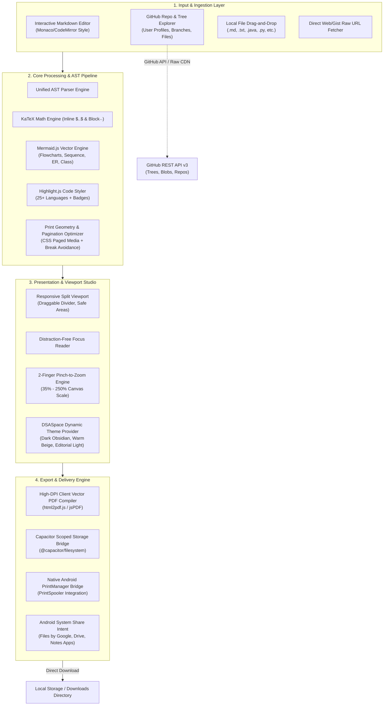

# CodexPress — Code, Notes & Document Publishing Studio

<p align="center">
  <em>An executive-grade publishing studio that transforms GitHub repositories, multi-language source code, and Markdown documentation into print-perfect vector PDFs with real-time preview, KaTeX math typesetting, and native Android tablet optimization.</em>
</p>

<p align="center">
  
  
  
  
  
  
  
</p>

<p align="center">
  <!-- PRIMARY ACTION BUTTONS -->
  <a href="https://github.com/RayAashish/creativity-with-ai/releases/download/v2026.11.14/CodexPress-v1.0.0.apk">
    
  </a>
  <a href="https://github.com/RayAashish/creativity-with-ai/tree/main/markdown-to-pdf">
    
  </a>
</p>

---

## Overview & Key Highlights

### Problem Statement
Software engineers, computer science students, and researchers continuously work with complex repositories, architecture notes, and multi-language source code. When preparing technical documentation, interview prep guides, or system blueprints for offline study, executive review, or physical printing:
1. Conventional web-to-PDF tools destroy code block formatting and split critical functions across page breaks.
2. Standard Markdown viewers lack rigorous math formula typesetting ($\KaTeX$) and scalable vector diagrams ($\text{Mermaid}$).
3. Exploring remote codebases requires tedious downloading, manual extraction, or navigating unwieldy web tabs.
4. Cloud conversion services introduce latency, operational downtime, and severe security risks by transmitting proprietary codebase logic to third-party servers.

### Core Value Proposition
**CodexPress** completely eliminates these friction points by uniting an interactive repository browser, a dual-pane live markdown/code editor, and a high-fidelity publishing engine into a single unified client:
- **100% Client-Side & Air-Gapped:** Zero external document conversion servers. All markdown parsing, AST tokenization, code syntax styling, and PDF vector layout happen entirely inside the browser or Android WebView runtime.
- **Deep GitHub Explorer:** Enter any GitHub profile or repository URL to recursively traverse folders, inspect markdown documentation, or format raw source code files (`.java`, `.py`, `.ts`, `.cpp`, `.rs`, `.go`, etc.) with comprehensive language metadata badges.
- **Publication-Grade Geometry:** Supports ISO A4, US Letter, and US Legal formats in Portrait or Landscape with granular margin control, live pagination counters (`Page X of Y`), dynamic Table of Contents generation, and CSS print-break shielding.
- **Hardware-Accelerated Tablet Ergonomics:** Tailored for 2K touchscreens (e.g., Moto Pad 70 Pro) and mobile devices, featuring two-finger pinch-to-zoom, responsive Auto-Fit, distraction-free Focus Reader mode, and zero-permission scoped storage downloads.

### Feature Matrix

| Capability | Standard Markdown Exporters | CodexPress Studio |
| :--- | :---: | :---: |
| **Execution Topology** | Cloud Server / SaaS API | 100% Local / On-Device Client |
| **Mathematical Typesetting** | Raw TeX / Broken ASCII | Full KaTeX Inline & Block Engines |
| **Architectural Diagrams** | Plain Text / Monospace | Vector SVG Mermaid Charts (Flowcharts, Sequence, ER) |
| **GitHub Integration** | Readme link copy-paste only | Recursive Repo & Folder Explorer with Search |
| **Source Code Publishing** | Raw plain text | Styled publication layouts with language badges & line stats |
| **Touchscreen Gestures** | Fixed scale / pinch zoom breaks | 2-Finger Smooth Pinch-to-Zoom & Double-Tap Auto-Fit |
| **Android PDF Download** | Print Spooler dialog freeze | Direct Scoped Storage download + System Print bridge |
| **Page Break Control** | Random element splitting | CSS `break-inside: avoid` block shielding |
| **Typography & Styling** | Fixed default font | 5 Editorial Themes (Academic, Minimal, Tech, Modern, Dark) |

---

## System Architecture & Workflow

### High-Level Architecture Diagram



### Component Breakdown

#### 1. Presentation Layer
- **Header Toolbar (`src/components/Header.tsx`):** Houses brand emblem, document statistics, view mode switchers (Split, Editor, Preview), quick theme cycler, system print button, and a prominent, screen-bounded **Download PDF** trigger.
- **GitHub Explorer Panel (`src/components/GitHubExplorer.tsx`):** Asynchronous GitHub API client managing profile fetching, repository filtering, recursive Git tree decomposition, breadcrumb navigation, search indexing, and recent file bookmarks.
- **Interactive Input Panel (`src/components/InputPanel.tsx`):** Dual-mode interface supporting direct markdown editing, URL ingestion, and local file uploads with synchronized line/word/character counters.
- **Document Preview Studio (`src/components/PreviewPanel.tsx`):** Virtualized paper preview container simulating physical print dimensions with real-time pinch-to-zoom, auto-fit width calculations, and outline navigation.

#### 2. Core Engine & Transformation
- **Syntax & Language Helper (`src/utils/codeHelper.ts`):** Detects 25+ programming languages, extracts file metadata (line count, byte size, directory breadcrumbs), and synthesizes raw code into publication-grade document headers.
- **Markdown & Math Compiler (`src/utils/markdownParser.ts`):** Converts markdown text into sanitized HTML, delegating equation tokens to KaTeX and diagram code blocks to Mermaid's vector renderer.
- **Editorial Stylesheet Generator (`src/utils/themeStyles.ts`):** Generates scoped CSS for typography, code callouts, zebra tables, and `@media print` rules enforcing page-break avoidance on headers and figures.

#### 3. Data, Storage & Native I/O
- **Universal PDF Exporter (`src/utils/pdfExport.ts`):** Multi-runtime export controller. On web, triggers immediate high-DPI browser downloads; on Android, writes base64 PDF buffers into private app cache via `@capacitor/filesystem` and invokes the native Android Share sheet or Print Spooler.
- **Local Persistence Store:** Automatically stores the active document, scroll positions, custom theme choices, sidebar widths, and recent GitHub file paths in client-side `localStorage`.

---

## Project Structure

```
markdown-to-pdf/
├── android/                             # Android Studio Project Root
│   ├── app/
│   │   ├── build.gradle                 # Native app dependencies & SDK specifications
│   │   └── src/main/
│   │       ├── AndroidManifest.xml      # Scoped storage & Activity configurations
│   │       ├── java/com/markpdf/app/    # Native Capacitor Activity & bridges
│   │       └── res/                     # Adaptive icons, mipmap densities, XML vectors
│   │           ├── drawable/            # ic_launcher vector backgrounds & foregrounds
│   │           ├── mipmap-anydpi-v26/   # Adaptive icon XML manifests
│   │           └── mipmap-*/            # Rasterized fallback launcher icons (mdpi-xxxhdpi)
│   ├── build.gradle                     # Top-level Gradle configuration
│   └── settings.gradle                  # Gradle project modules
├── public/                              # Static public assets
├── src/                                 # React & TypeScript Source Code
│   ├── components/
│   │   ├── CodexPressLogo.tsx           # Official illuminated codex vector emblem
│   │   ├── GitHubExplorer.tsx           # GitHub repo, folder & code exploration suite
│   │   ├── Header.tsx                   # Top responsive navigation & action bar
│   │   ├── InputPanel.tsx               # Markdown editor & file upload interface
│   │   ├── PreviewPanel.tsx             # Interactive canvas preview & touch gesture engine
│   │   ├── SettingsPanel.tsx            # PDF geometry, theme & layout customization
│   │   └── TableOfContents.tsx          # Dynamic document outline & anchor navigator
│   ├── utils/
│   │   ├── codeHelper.ts                # Language mapping, metadata parser & code formatter
│   │   ├── githubService.ts             # GitHub REST API v3 client & recursive tree parser
│   │   ├── markdownParser.ts            # Markdown, KaTeX & Mermaid compiler pipeline
│   │   ├── pdfExport.ts                 # Dual-runtime (Web + Android) PDF generator
│   │   ├── sampleMarkdown.ts            # Built-in technical showcase documents
│   │   └── themeStyles.ts               # Dynamic CSS theme engine & print break rules
│   ├── App.tsx                          # Root application controller & state orchestrator
│   ├── index.css                        # Global styles & DSASpace CSS variable definitions
│   ├── main.tsx                         # React entrypoint
│   └── types.ts                         # TypeScript interfaces & domain models
├── capacitor.config.ts                  # Capacitor hybrid runtime bridge configuration
├── index.html                           # Single-page HTML harness & favicon
├── package.json                         # Node.js project manifest & scripts
├── tsconfig.json                        # TypeScript compiler options
└── vite.config.ts                       # Vite bundler configuration
```

---

## Getting Started & Local Setup

### Prerequisites
- **Node.js**: v18.0.0 or later (v20+ recommended)
- **Package Manager**: `npm` (v9+) or `yarn` / `pnpm`
- **Java Development Kit (JDK)**: OpenJDK 17 or 21 (required for Android APK compilation)
- **Android SDK**: Android SDK Platform 34 or 35 with build-tools (required for native APK builds)

### Installation & Run

1. **Clone the repository:**
   ```bash
   git clone https://github.com/RayAashish/creativity-with-ai.git
   cd creativity-with-ai/markdown-to-pdf
   ```

2. **Install dependencies:**
   ```bash
   npm install
   ```

3. **Configure environment (optional):**
   ```bash
   cp .env.example .env
   # Add your optional VITE_GITHUB_TOKEN to avoid GitHub unauthenticated rate limits (60 req/hr)
   ```

4. **Launch development server:**
   ```bash
   npm run dev
   ```
   Open [http://localhost:5173](http://localhost:5173) in your browser.

5. **Build web production bundle:**
   ```bash
   npm run build
   npm start
   # Server listens on http://localhost:3001
   ```

---

## Compiling & Deploying Native Android APK

### 1. Build and Synchronize Web Assets
```bash
npm run build
npx cap sync android
```

### 2. Compile Debug APK via Gradle
```bash
export ANDROID_HOME="$HOME/Library/Android/sdk"
export JAVA_HOME="/opt/homebrew/Cellar/openjdk@21/21.0.10/libexec/openjdk.jdk/Contents/Home" # Adjust path to your JDK

cd android
./gradlew assembleDebug
cd ..
```
The compiled APK will be located at:
```
android/app/build/outputs/apk/debug/app-debug.apk
```

### 3. Install on Connected Device via ADB
```bash
adb install -r android/app/build/outputs/apk/debug/app-debug.apk
adb shell am start -n com.markpdf.app/.MainActivity
```

---

## Privacy, Permissions & Security

- **Zero Cloud Data Transmission:** Documents, code files, and exported PDF streams never leave the user's local device. There are no remote analytics, third-party trackers, or cloud storage synchronization scripts.
- **Modern Scoped Storage Compliance:** The Android application targets Android 14/15 (API 34/35) and fully complies with modern Android Scoped Storage guidelines. It requires **zero dangerous media permissions** (`READ_MEDIA_IMAGES`, `WRITE_EXTERNAL_STORAGE`). Generated PDFs are written directly into standard cache and handed off safely through the Android System Share Sheet.
- **Secure Token Handling:** GitHub Personal Access Tokens (PATs) entered to increase API rate limits are stored strictly in client-side browser `localStorage` and sent solely in HTTPS `Authorization` headers to official `api.github.com` endpoints.

---

## License & Attribution

This project is licensed under the **MIT License** — see the [LICENSE](LICENSE) file for complete details.

Developed with precision by [Aashish Kumar Ray](https://github.com/RayAashish) as part of the *Creativity with AI* engineering suite.
