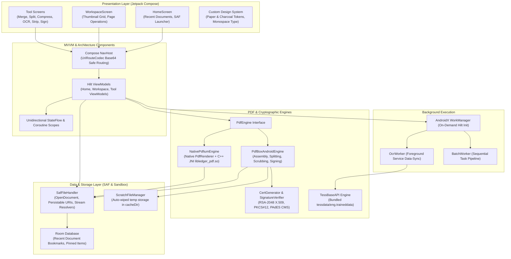

# Ledger — Offline-Only Air-Gapped Android PDF Toolkit

<p align="center">
  <em>An air-gapped, zero-telemetry, 100% on-device Android PDF toolkit engineered for high-security environments, legal professionals, journalists, and privacy purists.</em>
</p>

<p align="center">
  
  
  
  
  
  
  
</p>

<p align="center">
  <a href="https://github.com/RayAashish/creativity-with-ai/releases/download/v2026.11.14/ledger-airgapped-release.apk">
    
  </a>
</p>

---

## Overview & Key Highlights

### Problem Statement
Standard mobile PDF toolkits rely heavily on cloud processing APIs, covert telemetry, and ad trackers. For confidential legal contracts, medical charts, financial records, and investigative journalism, transmitting unencrypted document payloads to third-party servers represents an unacceptable compliance violation and privacy breach.

### Core Value Proposition
- **100% Offline & Physically Air-Gapped**: The production release manifest declares zero network permissions. `android.permission.INTERNET`, `ACCESS_NETWORK_STATE`, and `ACCESS_WIFI_STATE` are stripped at manifest merger with `tools:node="remove"`.
- **Zero Telemetry & Third-Party SDKs**: No Firebase, no Google Play Services dependencies, no crash reporters, and zero tracking libraries.
- **Strict Storage Access Framework (SAF)**: Ledger never requests broad filesystem storage permissions (`MANAGE_EXTERNAL_STORAGE` or `READ_EXTERNAL_STORAGE`). Documents are accessed strictly through user-directed SAF contracts (`OpenDocument`, `CreateDocument`).
- **Deterministic Ephemeral Scratch Isolation**: Intermediates are isolated in an app-private sandbox and wiped immediately via structured execution blocks and boot-time sweeps.
- **Dense Document Design System**: Crafted for high information density with custom paper-tone tokens (`#F5F2EB` Paper Light, `#141414` Charcoal Dark, `#9B3A2E` Oxblood), monospace technical readouts (`JetBrains Mono`), and tactile haptic feedback.

### Feature Matrix

| Capability | Description | Engine / Method |
|:---|:---|:---|
| **Merge Files** | Combine multiple PDFs via SAF with drag-and-drop reordering & alternating duplex interleaving. | `PdfBox-Android` memory stream assembler |
| **Split Operations** | Split by page ranges (`1-3, 5, 8-12`), every *N* pages, or by bookmark outline chapters. | `RangeParser` + `PdfBox-Android` |
| **Local Compression** | Downsample and re-quantize scanned/image-heavy PDFs with quality presets and target KB budget mode. | JPEG quality re-quantization & raster rebuild |
| **Air-Gapped OCR** | Extract text and generate an invisible searchable text layer over rasterized PDF pages. | Bundled `Tesseract` (`tess-two`) in foreground `WorkManager` |
| **Metadata Scrubbing** | One-tap removal of Document Info dictionary, XMP streams, comments, and form tracking IDs with diff preview. | Low-level COS dictionary scrub |
| **Visual & Digital Signatures** | Interactive bezier canvas for stamp signatures; cryptographic PAdES digital signing with self-signed certs or PKCS#12 imports. | BouncyCastle CMS/PKCS#7 (`bcpkix-jdk18on`) |
| **Document Workspace** | Interactive thumbnail grid, 90°/180° page rotations, page extraction, deletion, and selection. | Android Native `PdfRenderer` + C++ NDK JNI |
| **Batch Automation** | Chain recurring sequential operations (e.g. *Scrub Metadata → Compress → Sign*) into automated pipelines. | Foreground `BatchWorker` WorkManager |

---

## System Architecture & Workflow

### High-Level Architecture Diagram



### Component Breakdown

#### Presentation Layer
- **Jetpack Compose UI**: Single-Activity architecture (`MainActivity`) hosting modular composable screens with unidirectional data flow.
- **Custom Tokens**: Replaces generic Material 3 components with dense, document-tool styling: compact 58dp rows, ink-bordered page cards, and dual-theme warm paper off-white (`#F5F2EB`) and deep charcoal (`#141414`).
- **URL-Safe Navigation (`UriRouteCodec`)**: Encodes arbitrary SAF content URIs into Base64 URL-safe tokens, preventing query parameter collision and double-decoding defects during screen transitions.

#### Core Engine & Processing
- **Structural Engine (`PdfBoxAndroidEngine`)**: Handles PDF structural mutation, cross-document object merging, page rotation/extraction, and COS-level metadata purging.
- **Native Preview Engine (`NativePdfiumEngine` & NDK)**: Uses Android's native `android.graphics.pdf.PdfRenderer` backed by native Pdfium along with C++ JNI bindings (`libledger_pdf.so`) to rasterize high-fidelity thumbnails directly to hardware-backed bitmaps with proportional aspect-ratio preservation.
- **Security & Cryptography (`CertGenerator` / `SignatureVerifier`)**: In-app RSA-2048 keypair generator creating standard X.509 certificates and PKCS#12 keystores. Digital PAdES signing verifies byte ranges and validates signer identity using BouncyCastle.
- **OCR Foreground Service (`OcrWorker`)**: Executes bundled Tesseract optical character recognition inside a foreground service with `dataSync` type, surfacing live per-page notifications and cancellation support.

#### Data & I/O
- **Storage Access Framework (`SafFileHandler`)**: Mediates all input/output through user-authorized SAF URIs with persistable permission grants (`takePersistableUriPermission`).
- **Scratch File Isolation (`ScratchFileManager`)**: Intermediate working files are generated inside `context.cacheDir/ledger_scratch/` and cleaned via Kotlin `finally` blocks, boot-time sweeps, and manual cache purge.
- **Persistence (`LedgerDatabase`)**: Room database persisting recent file metadata, display names, and pinned bookmarks.

---

## Project Structure

```ascii
pdf-offline-toolkit/
├── app/
│   ├── src/
│   │   ├── airgapped/                    # Air-gapped build flavor
│   │   │   └── AndroidManifest.xml       # Strips INTERNET & network permissions
│   │   ├── main/
│   │   │   ├── AndroidManifest.xml       # Base manifest with SAF & foreground services
│   │   │   ├── assets/tessdata/          # Bundled offline OCR training data (eng.traineddata)
│   │   │   ├── cpp/                      # Native NDK C++ layer
│   │   │   │   ├── CMakeLists.txt        # CMake build configuration linking jnigraphics & log
│   │   │   │   ├── ledger_pdf_engine.h   # C++ engine header
│   │   │   │   └── ledger_pdf_jni.cpp    # JNI implementation & bitmap buffer operations
│   │   │   ├── java/org/ledger/pdf/
│   │   │   │   ├── LedgerApp.kt          # Application class with Hilt WorkManager config
│   │   │   │   ├── MainActivity.kt       # Single-Activity entry point & navigation host
│   │   │   │   ├── data/
│   │   │   │   │   ├── db/               # Room Database & RecentDocumentDao
│   │   │   │   │   ├── model/            # Domain models (DocumentInfo, PageInfo, Operations)
│   │   │   │   │   ├── repository/       # Document, Certificate, and Scratch repositories
│   │   │   │   │   └── saf/              # SafFileHandler for SAF permission & stream I/O
│   │   │   │   ├── di/                   # Hilt dependency injection modules (AppModule)
│   │   │   │   ├── engine/               # PdfEngine abstraction, PdfBox, and Native engines
│   │   │   │   ├── security/             # CertGenerator & SignatureVerifier (BouncyCastle)
│   │   │   │   ├── ui/
│   │   │   │   │   ├── components/       # Custom buttons, cards, badges, progress bars
│   │   │   │   │   ├── navigation/       # Screen routes & UriRouteCodec Base64 encoder
│   │   │   │   │   ├── screens/          # Home, Workspace, Merge, Split, Compress, OCR, Sign
│   │   │   │   │   └── theme/            # Color tokens, typography, and haptics
│   │   │   │   └── worker/               # WorkManager workers (OcrWorker, BatchWorker)
│   │   │   └── res/                      # Resource layouts, XML extraction rules, themes
│   │   ├── test/                         # JVM Unit tests (RangeParser, Scrub, Crypto, Scratch)
│   │   └── androidTest/                  # On-device connected tests (SAF flows, Engine preview)
│   ├── build.gradle.kts                  # App build configuration & version catalog links
│   └── proguard-rules.pro                # R8 & ProGuard optimization rules
├── gradle/
│   ├── libs.versions.toml                # Gradle Version Catalog
│   └── wrapper/                          # Gradle Wrapper binaries & config
├── build.gradle.kts                      # Root Gradle script
├── settings.gradle.kts                   # Project settings
├── LICENSE                               # GNU General Public License v3.0
└── README.md                             # Architectural specification & documentation
```

---

## Getting Started & Local Setup

### Prerequisites
- **Java Development Kit (JDK)**: OpenJDK 21 LTS (`export JAVA_HOME=...`)
- **Android SDK**: API 35 (Android 15) with platform-tools (`adb`)
- **Android NDK**: NDK r27+ (`27.0.12077973`)
- **CMake**: Version 3.22.1+

### Installation & Run

1. **Clone the repository:**
   ```bash
   git clone https://github.com/RayAashish/creativity-with-ai.git
   cd creativity-with-ai/pdf-offline-toolkit
   ```

2. **Verify Environment:**
   Ensure `local.properties` specifies your Android SDK directory:
   ```properties
   sdk.dir=/Users/<username>/Library/Android/sdk
   ```

3. **Build the Air-Gapped Release APK:**
   ```bash
   ./gradlew assembleAirgappedRelease
   ```
   The compiled, R8-optimized APK will be located at:
   ```
   app/build/outputs/apk/airgapped/release/app-airgapped-release.apk
   ```

4. **Install onto a Connected Device:**
   ```bash
   adb install -r app/build/outputs/apk/airgapped/release/app-airgapped-release.apk
   ```

5. **Execute Test Suites:**
   ```bash
   # Run all JVM unit tests
   ./gradlew testAirgappedDebugUnitTest testStandardDebugUnitTest

   # Run on-device instrumentation tests (device connected via adb)
   ./gradlew connectedAirgappedDebugAndroidTest
   ```

---

## Privacy, Permissions & Security

### Air-Gapped Network Policy
- The `airgapped` flavor physically removes all network capabilities at compile-time:
  ```xml
  <uses-permission android:name="android.permission.INTERNET" tools:node="remove" />
  <uses-permission android:name="android.permission.ACCESS_NETWORK_STATE" tools:node="remove" />
  <uses-permission android:name="android.permission.ACCESS_WIFI_STATE" tools:node="remove" />
  <uses-permission android:name="android.permission.CHANGE_WIFI_STATE" tools:node="remove" />
  ```
- No server endpoints, remote telemetry, or analytic libraries are integrated.

### Storage & Data Handling
- **Scoped Storage Access**: Documents are read directly via Android Content Provider streams without copying them to permanent app storage.
- **Scratch Directory Lifecycle**: Temporary intermediate files generated during rasterization, digital signing, or compression are isolated in `context.cacheDir/ledger_scratch/`. Each file is bounded by scoped execution wrappers that guarantee deletion upon operation completion, failure, or on next app startup.

---

## License & Attribution

Distributed under the **GNU General Public License v3.0** (GPL-3.0). See [`LICENSE`](LICENSE) for complete terms.
