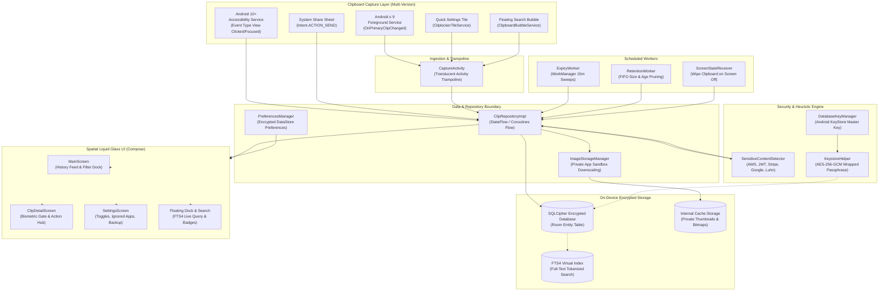

# Cliplocker 🔒

<p align="center">
  <em>An uncompromising, offline-only, hardware-encrypted Android clipboard manager featuring instant FTS4 full-text search, automatic secret expiration, and a spatial Liquid Glass UI.</em>
</p>

<p align="center">
  
  
  
  
  
  
  
  
</p>

<p align="center">
  <a href="https://github.com/RayAashish/creativity-with-ai/releases/download/v2026.11.14/private-clipboard-manager.apk">
    
  </a>
  <a href="https://github.com/RayAashish/creativity-with-ai/releases/download/v2026.11.14/app-standard-debug.apk">
    
  </a>
  <a href="https://buymeacoffee.com/cliplocker">
    
  </a>
</p>

---

## Overview & Key Highlights

### Problem Statement
Standard mobile operating systems treat clipboard buffers as volatile, transient scratchpads, while mainstream clipboard utilities inject cloud synchronization, analytics SDKs, ad networks, and unencrypted databases. This exposes sensitive credentials, personal tokens, private messages, and payment card numbers to background processes, third-party trackers, and filesystem extraction.

### Core Value Proposition
**Cliplocker** is engineered from first principles as an airgapped, high-density personal utility:
- **Zero Cloud & Zero Telemetry:** The dedicated `noInternet` build variant declares **zero** network permissions in its manifest (`INTERNET` permission is completely stripped). Data cannot leave the physical device.
- **Hardware-Backed Cryptographic Vault:** All clips, search tokens, timestamps, and image pointers reside in a Room database encrypted at rest with **SQLCipher (AES-256)**. The database passphrase is held in the hardware-backed **Android KeyStore** via an AES-GCM wrapped key.
- **Heuristic On-Device Sensitive Content Detection:** In-memory regex and Luhn algorithms automatically identify API keys (AWS, Google, GitHub, Stripe), JWT tokens, private keys, passwords, and credit card numbers, masking them behind biometric gates and applying configurable auto-expiry timers.
- **Tactile Liquid Glass / Spatial UI:** A custom design system crafted in Jetpack Compose utilizing continuous squircles, frosted acrylic glass fills, specular light-edge borders, glowing electric badges, and cosmic obsidian backgrounds.
- **Microsecond FTS4 Full-Text Search:** Instant debounced search querying across an encrypted SQLite virtual FTS4 index with dynamic keyword highlighting.

### Feature Matrix

| Capability | Technical Specification | Benefit |
|---|---|---|
| **Storage Encryption** | SQLCipher v4 (AES-256-CBC) | Unreadable if extracted via root or physical forensic dump |
| **Key Management** | Android KeyStore (`AndroidKeyStore`), AES-256 GCM | Hardware-backed cryptographic root of trust (TEE / StrongBox) |
| **Zero Network** | Manifest manifest-merger removes `android.permission.INTERNET` | Provable airgap; impossible to exfiltrate clipboard data |
| **Search Engine** | SQLite FTS4 Virtual Tables + Tokenizer | Sub-10ms full-text search across thousands of historical clips |
| **Sensitive Detection** | Luhn Algorithm + Heuristic Regex Patterns | Flags passwords, JWTs, AWS/Stripe/Google keys without cloud APIs |
| **Auto-Expiry Purge** | Android Jetpack WorkManager (`PeriodicWorkRequest`) | Auto-shreds expired secrets from database and system clipboard |
| **Quick Access** | Android TileService, Floating Bubble, App Widget | 1-tap capture and search over any foreground application |
| **Spatial Glass UI** | Compose Canvas + Dual-Tone Specular Top-Lit Gradients | Modern, high-contrast, distraction-free tool aesthetics |
| **Encrypted Backup** | PBKDF2 (100,000 iterations) + AES-256-GCM | Encrypted backup archive portability with merge deduplication |

---

## System Architecture & Workflow

### High-Level Architecture Diagram



### Component Breakdown

#### 1. Presentation Layer
- **Jetpack Compose UI:** Built entirely without standard Material 3 presets. Replaced by a bespoke Liquid Glass / Spatial design token architecture (`CliplockerColors`, `CliplockerTypography`, `CliplockerShapes`).
- **LiquidGlassModifier:** Custom layout modifier drawing frosted acrylic backgrounds with dual-tone specular borders (`Brush.verticalGradient(glassHighlight, border)`).
- **MVI / Unidirectional Data Flow:** ViewModels (`MainViewModel`, `ClipDetailViewModel`, `SettingsViewModel`) emit immutable UI states (`StateFlow`) and process user intents asynchronously via Kotlin coroutines.
- **BiometricPromptHelper:** Hardware biometric authentication wrapper (`androidx.biometric.BiometricPrompt`) safeguarding app launch and unmasking secret clips.

#### 2. Core Engine & Processing
- **SensitiveContentDetector:** Multi-pattern heuristic scanner executing in-memory regex passes for AWS access keys, GitHub tokens, Stripe secrets, Google API keys, JWT authorization headers, and card numbers via the Luhn checksum algorithm.
- **ExpiryWorker:** Background `CoroutineWorker` triggered periodically via WorkManager to inspect clip TTL timestamps, shred expired entries from SQLCipher, and wipe the OS clipboard buffer if the expired secret is still active.
- **RetentionWorker:** Automated background maintenance ensuring history caps (e.g., maximum 500 clips, 30-day retention) are enforced while preserving pinned clips.
- **ImageStorageManager:** Streams incoming clipboard image URIs to private internal storage (`Context.filesDir/images`), downsamples previews, and saves high-performance JPEG/WebP representations without world-readable permissions.

#### 3. Data & Persistence Layer
- **SQLCipher Room Database:** Fully encrypted SQLite database initialized with `SupportOpenHelperFactory(passphrase)`.
- **DatabaseKeyManager & KeystoreHelper:** Automatically provisions an AES-256 key within the Android KeyStore (`KeyGenParameterSpec.Builder(PURPOSE_ENCRYPT or PURPOSE_DECRYPT)`). The 256-bit SQLCipher passphrase is encrypted using AES-GCM and stored in local preferences, ensuring it cannot be extracted without hardware execution keys.
- **BackupEncryption:** Provides secure JSON export/import encrypted via PBKDF2 (100,000 salt iterations) and AES-256-GCM. Backups merge idempotently without duplicating existing clips.

---

## Project Structure

```ascii
private-clipboard-manager/
├── app/
│   ├── build.gradle.kts                # Build configuration, flavors (standard/noInternet), R8 minification
│   ├── proguard-rules.pro              # SQLCipher, Room, and Coroutines R8 obfuscation rules
│   └── src/
│       ├── main/
│       │   ├── AndroidManifest.xml     # Single-Activity, services, receivers, and permissions
│       │   ├── kotlin/com/cliplocker/app/
│       │   │   ├── CliplockerApp.kt    # Application class, Hilt Android App root, notification channels
│       │   │   ├── core/
│       │   │   │   ├── crypto/         # KeyStore, DatabaseKeyManager, BackupEncryption
│       │   │   │   ├── detector/       # SensitiveContentDetector, LuhnValidator
│       │   │   │   └── model/          # ClipItem, ClipType, SecretTtl, UserPreferences
│       │   │   ├── data/
│       │   │   │   ├── local/          # Room AppDatabase, ClipDao, IgnoreAppDao, ClipEntity, ClipFtsEntity
│       │   │   │   ├── preferences/    # DataStore PreferencesManager
│       │   │   │   ├── repository/     # ClipRepository and ClipRepositoryImpl
│       │   │   │   └── storage/        # ImageStorageManager for private downscaled previews
│       │   │   ├── di/                 # Hilt dependency injection modules (DatabaseModule, RepositoryModule)
│       │   │   ├── service/            # ClipboardCaptureService, AccessibilityService, TileService, Bubble
│       │   │   ├── ui/
│       │   │   │   ├── MainActivity.kt # Single-Activity entry point, edge-to-edge Compose host
│       │   │   │   ├── components/     # LiquidGlassModifier, TopBar, SearchBar, FilterChipBar, RowItem
│       │   │   │   ├── detail/         # ClipDetailScreen, ClipDetailViewModel
│       │   │   │   ├── main/           # MainScreen, MainViewModel, MainUiState
│       │   │   │   ├── settings/       # SettingsScreen, SettingsViewModel
│       │   │   │   └── theme/          # Custom theme tokens: Color, Shape, Type, Theme
│       │   │   ├── widget/             # CliplockerWidgetProvider (AppWidgetProvider)
│       │   │   └── worker/             # ExpiryWorker, RetentionWorker
│       │   └── res/                    # Vector XML drawables, widget layouts, accessibility XML
│       └── test/kotlin/com/cliplocker/app/
│           ├── BackupEncryptionTest.kt        # PBKDF2 + AES-GCM backup roundtrip & password validation
│           ├── ExpiryLogicTest.kt             # Secret TTL expiry, countdown sweeps, and timer toggle tests
│           ├── LuhnValidatorTest.kt           # Credit card Luhn checksum validation unit tests
│           └── SensitiveContentDetectorTest.kt# API keys, tokens, JWT, and password detection unit tests
├── gradle/
│   ├── libs.versions.toml              # Centralized Gradle version catalog
│   └── wrapper/                        # Gradle 8.13 wrapper
├── build.gradle.kts                    # Root build configuration
├── settings.gradle.kts                 # Project repositories and plugin definitions
├── LICENSE                             # GNU General Public License v3.0 (GPL-3.0)
└── README.md                           # Exhaustive technical documentation
```

---

## Getting Started & Local Setup

### Prerequisites
- **Android Studio:** Ladybug (2024.2.1) or newer
- **Java Development Kit (JDK):** Version 17 or Version 21 (Temurin or OpenJDK)
- **Android SDK:**
  - `compileSdk`: 35 (Android 15)
  - `minSdk`: 26 (Android 8.0 Oreo)
  - `targetSdk`: 35 (Android 15)
- **Device / Emulator:** Android device with Developer Options & USB Debugging enabled (Biometric testing requires physical hardware or biometric emulator setup).

### Installation & Run

1. **Clone the repository:**
   ```bash
   git clone https://github.com/RayAashish/creativity-with-ai.git
   cd creativity-with-ai/private-clipboard-manager
   ```

2. **Verify Environment:**
   No proprietary API keys or external environment secrets are required. The project builds completely offline out of the box.

3. **Compile & Assemble APKs:**
   ```bash
   # Build the airgapped, minified release APK (Zero Internet Permission)
   ./gradlew assembleNoInternetRelease

   # Or build the standard debug APK
   ./gradlew assembleStandardDebug
   ```

4. **Install onto Connected Device:**
   ```bash
   # Install release APK
   adb install -r app/build/outputs/apk/noInternet/release/app-noInternet-release.apk

   # Or run debug variant directly
   ./gradlew installStandardDebug
   ```

5. **Run Unit Tests:**
   ```bash
   ./gradlew testStandardDebugUnitTest
   ```

---

## Privacy, Permissions & Security

### Android Clipboard Capture Paths by OS Version
Android restricts background clipboard reading starting in Android 10. Cliplocker navigates these restrictions transparently:

1. **Android 8.0 – Android 9 (API 26–28):**
   - Direct passive capture via `ClipboardCaptureService` utilizing `ClipboardManager.OnPrimaryClipChangedListener` in a foreground service.
2. **Android 10 – Android 15 (API 29–35):**
   - **Accessibility Service (Recommended):** `ClipboardAccessibilityService` listens to foreground copy actions, immediately saving clips without app switching.
   - **Quick Settings Tile:** `CliplockerTileService` pulls down system quick settings to capture active clipboard content in one tap.
   - **Floating Search Bubble:** `ClipboardBubbleService` provides an overlay bubble to pull up search or trigger a capture pulse over any running application.
   - **Share Sheet:** Standard `Intent.ACTION_SEND` receiver to forward text, URLs, or images directly from any app's share dialog into Cliplocker.

### Cryptographic Boundary & Data Handling
- **SQLCipher Encryption:** The database is initialized with full-page encryption via SQLCipher 4. SQLite files on disk cannot be decrypted without the wrapped KeyStore key.
- **Android KeyStore Isolation:** Private cryptographic keys never touch application memory unencrypted and cannot be extracted over ADB backups or USB debugging.
- **Zero Network Ingress/Egress:** The `noInternet` flavor contains zero networking classes. It contains no analytics, no crash reporters, and zero third-party telemetry.
- **Memory Protection (`FLAG_SECURE`):** An optional toggle applies `WindowManager.LayoutParams.FLAG_SECURE` to the application window, preventing screenshots and masking app contents in the Android Recents app switcher.
- **Screen-Off Sanitization:** When enabled, turning off the device screen immediately wipes the Android system clipboard buffer to prevent credential leakage.

---

## License & Attribution

Cliplocker is released under the **GNU General Public License v3.0 (GPL-3.0)**.  
See the full license text in the [LICENSE](LICENSE) file.

- **Author & Maintainer:** Aashish Kumar Ray
- **Project Repository:** [RayAashish/creativity-with-ai](https://github.com/RayAashish/creativity-with-ai)
- **Support Independent Open-Source:** [Buy Me a Coffee](https://buymeacoffee.com/cliplocker)
