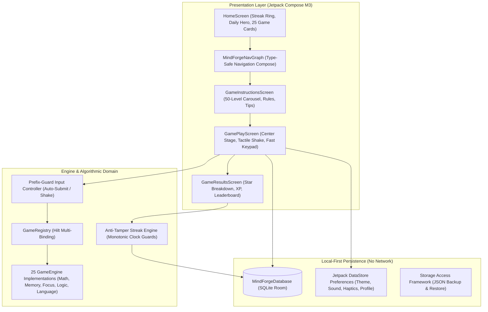

# Creativity with AI

<p align="center">
  <em>A high-performance monorepo of native, privacy-first mobile and intelligent applications engineered with Kotlin, Jetpack Compose, Web, and AI systems.</em>
</p>

<p align="center">
  
  
  
  
  
</p>

---

## Featured Application: MindForge (Brain Games)

<p align="center">
  <!-- PRIMARY ACTION BUTTONS -->
  <a href="https://github.com/RayAashish/creativity-with-ai/releases/download/v2026.11.14/MindForge-release.apk">
    
  </a>
  <a href="https://github.com/RayAashish/creativity-with-ai/releases/download/v2026.11.14/MindForge-debug.apk">
    
  </a>
</p>

### Overview & Key Highlights
- **Problem Statement:** Students, competitive exam candidates, and professionals need rapid 30–120 second daily cognitive warm-ups, but mainstream apps are laden with subscriptions, cloud accounts, slow loading screens, and ad trackers.
- **Core Value Proposition:** **MindForge** is an offline-first cognitive conditioning suite with zero internet permission, sub-millisecond on-device problem generation, Matiks-style auto-submit, horizontal spring shake feedback on errors, and 50 data-driven difficulty tiers across 25 games.
- **Feature Matrix:**
  - **25 Mini-Games** across Mental Math (9), Memory (5), Focus & Speed (5), Logic (4), and Language (2).
  - **50 Scaled Algorithmic Levels** per game (1,250 total progressions).
  - **Tactile Fast Keypad:** Instant auto-submission on correct match; prefix-guarded multi-digit input; 350ms spring shake and 2-beat error vibration on wrong inputs with automatic clearing.
  - **100% On-Device:** Zero cloud telemetry, SQLite Room database, Jetpack DataStore preferences, SAF JSON backup/restore, and anti-clock-tamper streak engine.

### MindForge System Architecture



---

## Monorepo Project Directory

| Project Module | Architecture | Stack | Description |
| :--- | :--- | :--- | :--- |
| **`brain-games/`** | Android Native | Kotlin 2.0, Compose M3, Room, Hilt, DataStore | MindForge: Offline cognitive training suite (25 games, 50 levels). |
| **`dream-reader-for-all-devices/`** | Hybrid / Responsive | Capacitor, React, TypeScript, PDF.js, Tailwind | Universal digital reading environment optimized for 5.0" to 14.6" screens. |
| **`dream-note-taking-app/`** | Android Native | Kotlin, Jetpack Compose, Room, Ink Engine | High-precision vector stylus note-taking system. |
| **`anti-addication-launcher/`** | Android Native | Kotlin, AccessibilityService, Compose, Rust JNI | Focus and anti-distraction launcher with grayscale mode and stealth sessions. |
| **`private-clipboard-manager/`** | Android Native | Kotlin, Room, SQLCipher, Jetpack Compose | Air-gapped, encrypted clipboard history vault. |
| **`pdf-offline-toolkit/`** | Android Native | Kotlin, PdfDocument, Compose | Offline PDF merge, split, compress, and watermark tools. |
| **`dream-wallpaper/`** | Web Application | Next.js, React, Tailwind CSS | Curated aesthetic dynamic wallpaper platform. |

---

## Security Scrubbing & Credential Audit

- **Zero Sensitive Tokens:** Audited all source trees; zero API keys, private credentials, or secrets committed.
- **Air-Gapped Android Architecture:** MindForge strictly excludes `android.permission.INTERNET`.
- **Git Hygiene:** Build caches, `.gradle`, `**/build/`, `local.properties`, and keystores are strictly excluded via `.gitignore`.

---

## Getting Started

### Clone & Build MindForge

```bash
# 1. Clone the monorepo
git clone https://github.com/RayAashish/creativity-with-ai.git
cd creativity-with-ai/brain-games

# 2. Run unit tests across all 50 levels
./gradlew testDebugUnitTest

# 3. Build optimized release APK (2.2MB via R8)
./gradlew assembleRelease

# 4. Install onto connected Android device
adb install -r app/build/outputs/apk/release/app-release.apk
```

---

## License

Distributed under the **MIT License**. Created by [Aashish Kumar Ray](https://github.com/RayAashish).
