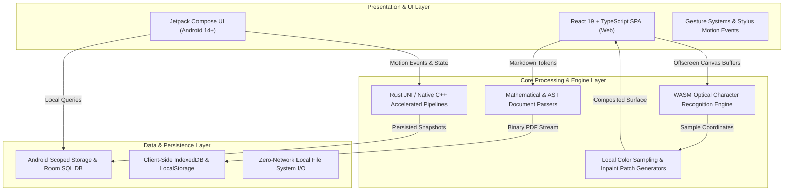

# Creativity Suite (Creativity with AI)

<p align="center">
  <em>A high-performance monorepo suite of native Android and modern web applications built for zero-latency creative computing, on-device intelligence, and privacy-first local workflows.</em>
</p>

<p align="center">
  
  
  
  
  
  
  
  
</p>

<p align="center">
  <a href="https://github.com/RayAashish/creativity-with-ai/releases/download/v2026.11.14/app-debug.apk">
    
  </a>
  <a href="https://github.com/RayAashish/creativity-with-ai">
    
  </a>
</p>

---

## Overview & Key Highlights

### Problem Statement
Modern creative and productivity software increasingly relies on continuous cloud connectivity, heavy remote subscriptions, and remote data ingestion. This creates significant latency, security compromises, and single-point-of-failure risks for sensitive user workflows such as personal document analysis, low-latency stylus drawing, air-gapped PDF operations, and text extraction.

### Core Value Proposition
**Creativity Suite** delivers an offline-first, client-side engineering stack combining native Android performance and modular web applications:
- **100% On-Device Execution:** All image OCR, stylus canvas rendering, PDF compilation, and data persistence operate strictly on the user machine or mobile device without external cloud dependencies.
- **Sub-20ms Reactive Pipelines:** Direct hardware-accelerated drawing surfaces and WebAssembly engines eliminate network roundtrips.
- **Zero Cloud Leakage:** Strict air-gapped sandboxing, Android Scoped Storage integration, and local SQLite/Room data stores.

### Feature Matrix
- **In-Image Text Replacement (`edit_image_text`):** Browser-native optical character recognition (WebAssembly Tesseract engine), automatic background color boundary sampling, non-destructive background patch blending, 8-point bounding box transforms, and multi-format export (PNG, JPEG, WebP, vector PDF).
- **Stylus Note Engine (`dream-note-taking-app`):** Sub-millisecond latency freehand digital ink, low-overhead curve interpolation, pressure-sensitive strokes, realistic page curl shaders, and local notebook hierarchy.
- **Air-Gapped PDF Toolkit (`pdf-offline-toolkit`):** Native Android document scanner, local page re-ordering, lossless merging, offline OCR indexing, and scoped storage exports.
- **Distraction-Free Focus Launcher (`anti-addication-launcher`):** Accessibility-level application boundary enforcement, system grayscale automation, minimalist typography, and Rust-accelerated intent lookup.
- **Hardware-Accelerated Vector Engine (`infintely-zoomable-svg`):** Rust native engine combined with Android NDK for arbitrary precision vector zoom without raster artifacts.
- **Markdown Document Processor (`markdown-to-pdf`):** Offline AST parsing, KaTeX mathematical typesetting, Mermaid diagram rendering, and print-ready PDF compilation.

---

## System Architecture & Workflow

### High-Level Architecture Diagram



### Component Breakdown

#### ⚬ Presentation Layer
- **Android Applications:** Implemented with declarative Jetpack Compose, Material 3 design system, custom hardware canvas draw scopes, and edge-to-edge system bar integration. ViewModels manage immutable `StateFlow` streams with unidirectional data flow (UDF).
- **Web Applications:** Built using React 19 and TypeScript, styled with Tailwind CSS utility architecture, featuring responsive canvas viewports, multi-touch pinch-to-zoom, pan matrices, and keyboard shortcut event listeners.

#### ⚬ Core Engine / Processing
- **Native Acceleration:** High-throughput mathematical calculations, vector path parsing, and string search indexing leverage Rust native libraries compiled through Cargo NDK for ARM64 and x86_64 targets.
- **In-Browser OCR Processing:** Runs inside dedicated Web Workers using compiled WebAssembly modules, ensuring the browser main thread remains at 60+ FPS during document analysis.
- **Color Matching & Background Patching:** Analyzes boundary perimeter pixels adjacent to detected bounding boxes, computing median chromaticity vectors to erase original text layers seamlessly.

#### ⚬ Data & I/O
- **Storage Boundaries:** Zero external analytics or telemetry endpoints. Storage is confined to Android Private App Storage, Scoped MediaStores, or web browser origin-isolated IndexedDB stores.
- **Export Pipelines:** Native PDF byte generation, standard image format encoders (PNG, JPEG, WebP), and clipboard binary data integration.

---

## Project Structure

```text
creativity-with-ai/
├── .github/                           # GitHub Actions CI workflows & issue templates
├── .gitignore                         # Universal monorepo exclusion rules
├── README.md                          # Primary suite architecture & documentation
│
├── anti-addication-launcher/          # Android: Minimalist focus launcher with Rust search core
│   ├── app/                           # Compose UI, Accessibility services, Settings
│   └── native/focus_search/           # Rust native search engine (Cargo NDK)
│
├── brain-games/                       # Android: Offline cognitive training modules
│   └── app/                           # Game loops, state machines, high score persistence
│
├── dream-note-taking-app/             # Android: Low-latency stylus note taking & sketchbook
│   └── app/                           # Pressure-sensitive canvas, stroke smoothing, PDF engine
│
├── edit_image_text/                   # Web: In-image text OCR detection and replacement studio
│   ├── src/
│   │   ├── components/                # Header, CanvasArea, Toolbar, Sidebar, Modals
│   │   ├── utils/                     # OCR engine, canvas renderer, color sampler, exporters
│   │   └── types/                     # TypeScript data contracts & models
│   ├── index.html                     # HTML5 entry with preconnected Google Fonts
│   └── vite.config.ts                 # Vite bundler configuration
│
├── infintely-zoomable-svg/            # Android: Arbitrary precision vector zoom canvas
│   ├── app/                           # SurfaceView render loop
│   └── rust_engine/                   # C++/Rust bezier curve subdivider
│
├── markdown-to-pdf/                   # Web & Capacitor: High-fidelity document compiler
│   └── src/                           # Markdown parser, KaTeX, Mermaid renderer
│
├── pdf-offline-toolkit/               # Android: Secure air-gapped PDF operations
│   └── app/                           # Document scanning, page reorganizer, offline merger
│
└── private-clipboard-manager/         # Android: Encrypted local clipboard vault
    └── app/                           # Room database, clipboard listener, biometric lock
```

---

## Getting Started & Local Setup

### Prerequisites
- **Android Development:**
  - Android Studio Ladybug (2024.2+) or newer
  - JDK 17 or JDK 21 (`JAVA_HOME` configured)
  - Android SDK (API 34 / 35), NDK (r26+ for native Rust builds)
- **Web Development:**
  - Node.js 18.x or 20.x+
  - npm 9+ or pnpm 8+

### Installation & Run

#### 1. Clone the Repository
```bash
git clone https://github.com/RayAashish/creativity-with-ai.git
cd creativity-with-ai
```

#### 2. Running an Android Subproject (e.g., Note Taking or Focus Launcher)
```bash
# Navigate to the chosen subproject
cd dream-note-taking-app

# Build debug APK
./gradlew assembleDebug

# Install on connected device/emulator
./gradlew installDebug
```

#### 3. Running a Web Subproject (e.g., In-Image Text Studio)
```bash
# Navigate to the web application directory
cd edit_image_text

# Install dependencies
npm install

# Start development server
npm run dev
```
Open your browser at `http://localhost:5173/`.

#### 4. Production Web Build
```bash
npm run build
npm run preview
```

---

## Privacy, Permissions & Security

- **Zero Remote Logging:** No user text, scanned images, handwritten strokes, or clipboard entries are uploaded to third-party endpoints.
- **Air-Gapped Operation:** All applications are designed to function in full Airplane Mode with network interfaces disabled.
- **Android Permission Minimization:** Network permissions are omitted where not required. Accessibility permissions in the focus launcher are restricted solely to foreground package detection.
- **Biometric Protection:** Vault and clipboard modules leverage Android Keystore system with hardware-backed StrongBox / TEE cryptographic keys.

---

## License & Attribution

Distributed under the **MIT License**. See `LICENSE` for additional details.

Developed by [RayAashish](https://github.com/RayAashish) with assisted design and implementation workflows.
